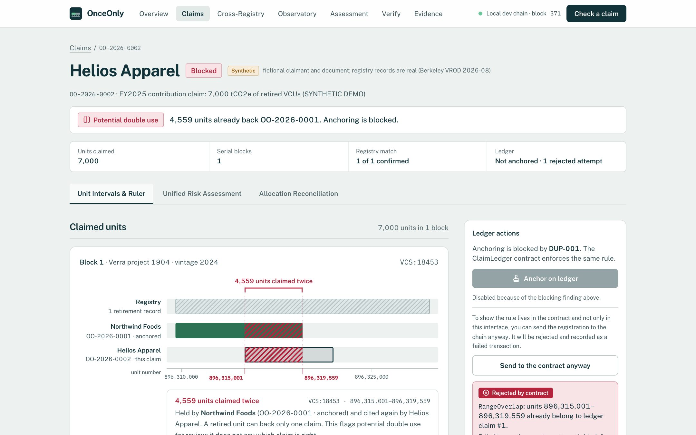
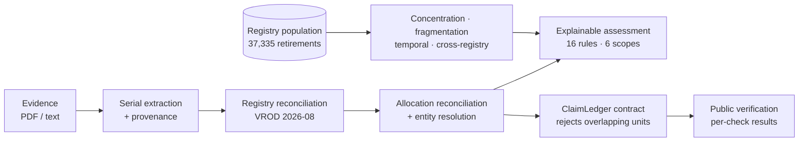
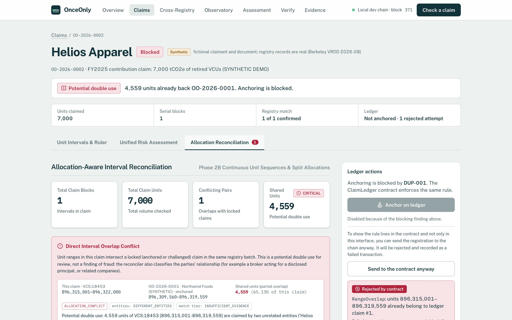
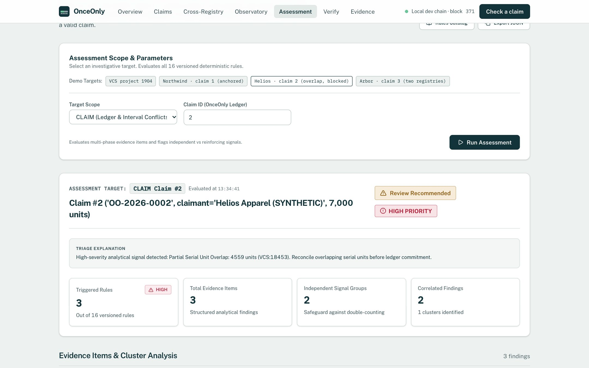
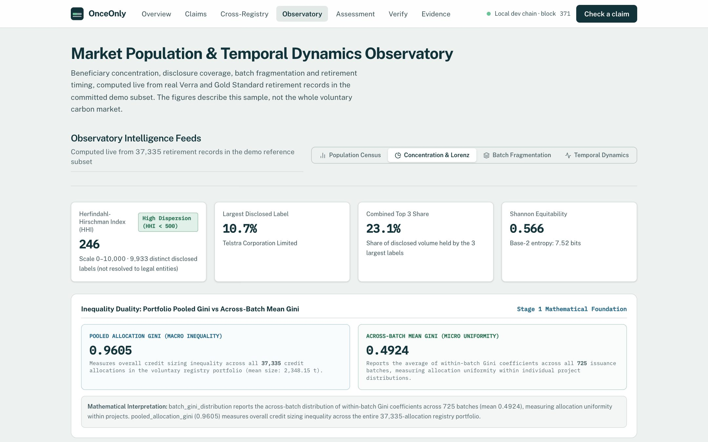
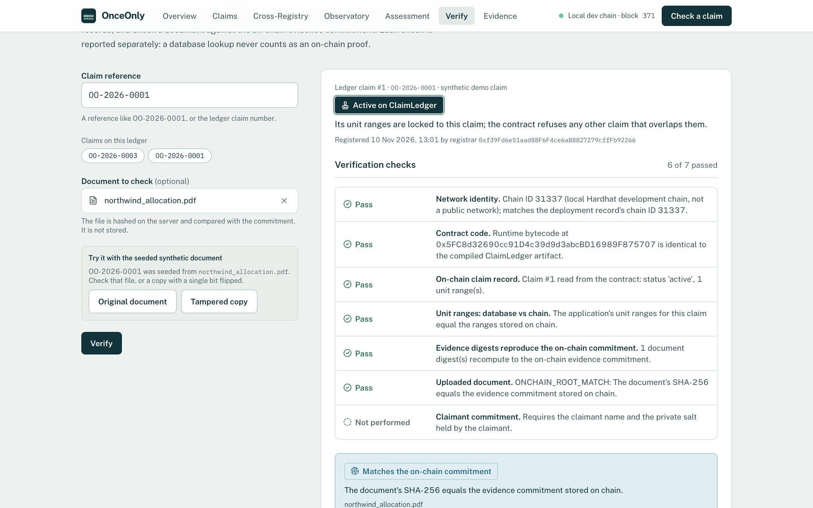
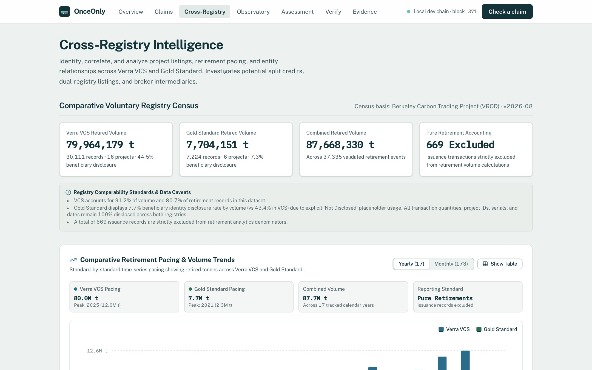
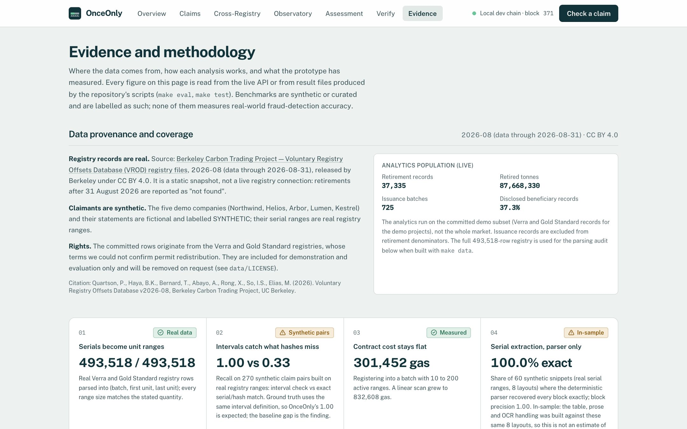

<div align="center">


# OnceOnly

### Every retired tonne, claimed once.

**A carbon-credit claim integrity and investigation platform.**<br>
Carbon registries make sure a credit is retired once. OnceOnly checks what happens next: whether the same retired units back more than one public climate claim. It then explains each signal with its evidence, counterevidence and limits.

<p>


</p>

[**Submission**](#submission-materials) · [**Problem**](#the-problem) · [**What it does**](#what-onceonly-does) · [**Product**](#product-tour) · [**Data**](#data-and-provenance) · [**Methods**](#methodology) · [**Trust**](#verification-and-trust-boundaries) · [**Evaluation**](#evaluation) · [**Run it**](#run-it) · [**Limits**](#limitations)



<sub>A real Verra retirement (Berkeley VROD 2026-08, batch 18453). Claimants are synthetic. Transactions run on a local Hardhat development chain.</sub>

</div>

---

## Submission materials

| Item | Location | Status |
|---|---|---|
| Presentation (PPTX) | [`docs/submission/OnceOnly_DATANOVA_Final_Presentation.pptx`](docs/submission/OnceOnly_DATANOVA_Final_Presentation.pptx) | Ready |
| Presentation (PDF) | [`docs/submission/OnceOnly_DATANOVA_Final_Presentation.pdf`](docs/submission/OnceOnly_DATANOVA_Final_Presentation.pdf) | Ready |
| Working demo | One container: `make docker-build && make docker-run`, then open http://127.0.0.1:7860. Public URL: see [deployment](#public-deployment) | Local demo verified. Public hosting needs the owner's account |
| Demo runbook and script | [`FINAL_DEMO_RUNBOOK.md`](docs/submission/FINAL_DEMO_RUNBOOK.md) · [`FINAL_DEMO_SCRIPT.md`](docs/submission/FINAL_DEMO_SCRIPT.md) | Ready |
| Submission form text | [`FINAL_DEVPOST_SUBMISSION_CONTENT.md`](docs/submission/FINAL_DEVPOST_SUBMISSION_CONTENT.md) | Ready; owner-specific fields marked |
| Release QA | [`docs/FINAL_RELEASE_QA_REPORT.md`](docs/FINAL_RELEASE_QA_REPORT.md) | Commands, results and skipped checks |

## The problem

A retirement certificate says *"these units are used up."* It does not say *who may claim them*.

Companies cite retired units in sustainability reports, product labels and websites, often through brokers who split one retirement across several buyers. If two claims cite the same units, each looks valid when read alone. Checking this today means reading documents side by side, and the usual shortcut, comparing hashes or serial strings, misses most overlaps, because overlapping claims usually cite *different* strings in *different* documents.

The registry data that could settle such questions is fragmented and hard to read:

- Unit numbers restart in every issuance batch.
- Most retirements name no beneficiary: 62.7 % of the records analysed here explicitly disclose none.
- Brokers retire "on behalf of" clients.
- Similar projects appear on more than one registry.

> [!NOTE]
> OnceOnly does **not** rate credit quality, additionality or permanence, and it does not decide which of two claims is legitimate. Every signal is an investigative indicator for a human reviewer, not a finding of fraud.

## What OnceOnly does

| | Capability | What it means |
|:-:|---|---|
| **1** | **Reads evidence** | Extracts registry serials from a PDF, text file or pasted statement with a deterministic parser. Every block keeps its source text. Hashes each document (SHA-256) |
| **2** | **Reconciles with the registry** | Each serial becomes an inclusive unit interval inside one `(registry, batch)` namespace. It is checked against real Verra and Gold Standard retirement records |
| **3** | **Reconciles allocations** | Interval geometry (exact, partial, containment, adjacent…) is combined with entity resolution, so a broker retiring for a disclosed client, related companies and a legitimate split of one retirement are told apart from a conflict between unrelated claimants |
| **4** | **Profiles the context** | Beneficiary disclosure and concentration, batch fragmentation, retirement timing anomalies, and candidate links between projects across registries |
| **5** | **Assesses explainably** | Sixteen deterministic rules across six scopes (claim, batch, project, entity, cross-registry, ad hoc). Each finding shows its threshold, evidence, counterevidence, missing information and next step. Correlated signals are grouped so they cannot double-count |
| **6** | **Anchors and verifies** | Accepted claims are registered on `ClaimLedger`, a smart contract that itself refuses any overlapping range. Anyone can read a claim back and check a document against its commitment, with every check reported separately |



## Product tour

| Route | Purpose |
|---|---|
| `/overview` | Investigation workflow, ledger state, system status |
| `/claims`, `/claims/new`, `/claims/:id` | Check a claim. Claim detail has three tabs: the **Ruler** (unit intervals against the registry and other claims), **Unified Risk Assessment** and **Allocation Reconciliation** |
| `/cross-registry` | Candidate Verra and Gold Standard project pairs, side-by-side comparison, entity and broker-delegation studio |
| `/observatory` | Population census, disclosure coverage, concentration (HHI, entropy, Lorenz), batch fragmentation, temporal activity, bursts and zero-activity intervals |
| `/assessment` | Multi-scope explainable assessment and the versioned 16-rule catalog |
| `/verify` | Public verification portal: network, deployed code, on-chain record, ranges, evidence commitment, document and claimant checks |
| `/evidence` | Data provenance, methodology documents, benchmark results and their limits |

<table>
  <tr>
    <td width="50%"><br><b>Allocation reconciliation.</b> Shared units, the allocation class, the entity relationship and a next step.</td>
    <td width="50%"><br><b>Explainable assessment.</b> Rule, metrics, limitations and dependency grouping.</td>
  </tr>
  <tr>
    <td><br><b>Observatory.</b> Population metrics, reproduced independently (Sprint 3.4.1 audit).</td>
    <td><br><b>Verification.</b> On-chain proofs and off-chain lookups are reported separately.</td>
  </tr>
  <tr>
    <td><br><b>Cross-registry.</b> Candidate project links, never treated as proof of identity.</td>
    <td><br><b>Evidence.</b> Provenance, methods and limits on one page.</td>
  </tr>
</table>

## Data and provenance

| Data | Nature | Detail |
|---|---|---|
| Berkeley Carbon Trading Project, *Voluntary Registry Offsets Database* v2026-08 | **Real** | 493,518 registry rows: 307,416 Verra retirements, 166,478 Gold Standard retirements and 19,624 Verra issuances. Data runs through 2026-08-31. Released by Berkeley under CC BY 4.0. Built locally with `make data` (about 67 MB download) |
| Committed demo subset `data/reference/demo_subset.csv.gz` | **Real** subset | 38,004 rows across 22 projects: 37,335 retirements (87,668,330 t, 725 batches) and 669 issuances. This is the population used by the analytics and the demo |
| Demo claimants and statements (`data/demo/`) | **Synthetic** | Northwind, Helios, Arbor, Lumen and Kestrel are fictional and labelled SYNTHETIC; their serial ranges are real |
| Benchmarks (`data/benchmarks/`) | **Curated** | 124 entity-resolution pairs and 36 allocation scenarios, written by the project team |

**Rights.** The code is MIT licensed. `data/` is not covered by the MIT licence. The registry rows originate from Verra and Gold Standard, whose terms we could not confirm permit redistribution. They are included for demonstration and evaluation and will be removed on request. See [`data/LICENSE`](data/LICENSE).

## Methodology

| Area | Approach | Document |
|---|---|---|
| Ingestion | Non-destructive normalization: raw values kept, mojibake repaired, ambiguous dates tagged rather than assumed | [Data quality](docs/DATANOVA_DATA_QUALITY.md) |
| Serial extraction | Deterministic multi-pass parser (strict, table columns, prose ranges, OCR letter-O) with provenance on every block | [Extraction evaluation](docs/DATANOVA_EXTRACTION_EVALUATION.md) |
| Entity resolution | Legal-suffix-aware normalization, intermediary parsing ("on behalf of", "c/o"), blocking, explainable multi-feature matching. Similar names never establish legal identity | [Methodology](docs/DATANOVA_ENTITY_RESOLUTION_METHODOLOGY.md) |
| Allocation reconciliation | Closed-interval algebra (`Q = e − s + 1`) in isolated `(registry, batch)` namespaces. Six geometric classes and eight allocation classes | [Methodology](docs/DATANOVA_ALLOCATION_RECONCILIATION_METHODOLOGY.md) |
| Concentration and fragmentation | HHI and Shannon entropy over **disclosed** volume. Pooled versus within-batch Gini. Absolute micro-claims (≤ 10 t) kept separate from relative small allocations (≤ 1 % of a batch) | [Stage 1](docs/DATANOVA_PHASE_2C_STAGE_1_METHODOLOGY.md) · [Specification](docs/DATANOVA_PHASE_2C_MATHEMATICAL_SPECIFICATION.md) |
| Temporal | Continuous calendars, rolling velocity, leave-one-out MAD bursts (k = 3). Zero activity in the sample is not treated as proof of dormancy | [Stage 2](docs/DATANOVA_PHASE_2C_STAGE_2_FINAL_CORRECTIONS_REPORT.md) |
| Cross-registry | Composite project similarity. An identical ID on two registries is flagged as an identifier *collision*, never as the same asset | [Stage 3](docs/DATANOVA_PHASE_2C_STAGE_3_IMPLEMENTATION_REPORT.md) |
| Assessment | Sixteen deterministic rules, dependency groups, counterevidence kept separate from caveats, non-accusatory statuses (`REVIEW_RECOMMENDED`, `INSUFFICIENT_EVIDENCE`, …) | [Methodology](docs/DATANOVA_EXPLAINABLE_ASSESSMENT_METHODOLOGY.md) |

Every population figure in the Observatory was reproduced by an independent SQL computation. Errors found in an earlier report were corrected with a dated erratum. See the [Sprint 3.4.1 audit](docs/DATANOVA_PHASE_3_SPRINT_3_4_1_METRICS_RECONCILIATION_AUDIT.md).

## Verification and trust boundaries

| Component | Status |
|---|---|
| Registry records | Real, from a static snapshot (2026-08-31). Not a live registry connection |
| Claimants and claim documents | Synthetic |
| Blockchain | Real transactions on a **local Hardhat development chain** (chain ID 31337), **not** a public network. The contract has not been deployed to a public network |
| Registrar | The backend holds the registrar key and is a trusted operator. Claimants do not sign registrations |
| Document verification | `ONCHAIN_ROOT_MATCH` when a document's SHA-256 is the on-chain commitment. `ONCHAIN_MEMBERSHIP_PROVEN` when it belongs to a digest list that recomputes to the commitment (the list is shown so anyone can redo the arithmetic). A database record alone is reported as `OFFCHAIN_RECORD_ONLY`, never as an on-chain proof |
| Deployment check | The deployed runtime bytecode is compared with the compiled `ClaimLedger` artifact. Publicly known Hardhat keys are refused on any chain other than 31337 |
| What a hash match proves | The bytes are unchanged since registration, not that the document is true |

**Why a contract at all?** Claims come from competitors, brokers and auditors in different jurisdictions. The contract gives a neutral first-come order, an invariant no party can bypass (no overlapping unit ranges in a batch) and append-only challenge history. With a single trusted registrar on a local chain, those properties hold only to the extent that operator is trusted. A public deployment with claimant signatures is future work.

## Evaluation

All numbers come from scripts in this repository. Results are in [`eval/results/`](eval/results/).

| Measurement | Result | How to read it |
|---|---|---|
| Registry serials parsed into unit ranges (full VROD) | 493,518 / 493,518, all quantity-consistent | Real data |
| Overlapping retirements inside one batch | 0 of 307,416 Verra; 5 Gold Standard pairs | Real data. The GS pairs are registry data inconsistencies, not findings about any organisation |
| Apparent overlaps if the batch is ignored | 11,631 Verra + 147,880 GS adjacent pairs | Why every range is keyed by registry **and** batch |
| Double use, 270 synthetic claim pairs | Engine and contract both P = R = 1.000; hash/string baseline recall 0.333; batch-blind P = 0.857 | Ground truth uses the engine's interval definition, so this verifies the implementation and shows what simpler methods miss. **Not real-world accuracy** |
| Entity resolution, 124 curated pairs | OnceOnly P = 1.000, R = 0.964; exact-string R = 0.157; token match ≥ 85: P = 0.750 | Curated by the team. Tests the specified behaviour |
| Allocation reconciliation, 36 curated scenarios | Expected allocation class 36/36 | A naive interval matcher also scores 1.00 on the binary label. The added value is the class (split, broker, related parties, conflict…) |
| Serial extraction, 60 synthetic snippets (8 layouts) | 100 % exact, block precision 1.000; 15 adversarial distractor tests pass | **In-sample**: layout handling was built against these templates. AI extraction is **not measured** |
| Registration gas, batch with 10 → 200 active ranges | Flat 301,452 (hinted sorted list); linear v0 reaches 832,608 | Local chain |

## Run it

**Requirements:** Python 3.12, Node 20+ (tested on Node 26), `make`. Docker is optional.

### One container (closest to the public demo)

```bash
make docker-build
make docker-run         # http://127.0.0.1:7860
```

The container starts a private local chain, deploys the contract, seeds the five-claim story and serves the API and UI. It runs in **public-demo mode**:

- Ledger writes return 403.
- Claim checks are rate-limited.
- State resets on every start.

It prints the demo fingerprint at boot. It uses about 280 MB of memory.

### Development stack

```bash
make setup               # .venv, Python/contract/web dependencies, .env from .env.example, compile
make chain               # terminal 1: Hardhat node on 127.0.0.1:8545
make deploy && make api  # terminal 2: deploy ClaimLedger, FastAPI on 127.0.0.1:8000
make web                 # terminal 3: Vite on 127.0.0.1:5173
make seed                # load the demo story; make demo-check prints its fingerprint
```

If port 8000 is taken, run the API elsewhere and point the tools at it, for example `ONCEONLY_API=http://127.0.0.1:8010` for `make web`, `make seed`, `make demo-check` and `make e2e`. The `.env` defaults use the **publicly known Hardhat development keys**, which work only on the local chain. Never put a real or funded key there.

### Reproduce the demo state

```bash
make reset               # wipe app state and deploy a fresh ClaimLedger; then restart the API
make seed
make demo-check          # fingerprint c544f5897354081cf1d20efb366b951f14d2b8ffa69bcb87b105cfdc0df6483b
```

### Tests

| Command | What it runs | Last result |
|---|---|---|
| `make test-backend` | pytest: parser, normalization, reference, entity resolution, reconciliation, analytics, assessment, verification trust, demo targets | 271 passed |
| `make test-contracts` | Hardhat: invariants, adversarial hints, gas | 24 passing |
| `cd frontend && npm run lint && npm run build` | oxlint, TypeScript, Vite | Clean |
| `make e2e` | 13-step lifecycle on a fresh ledger (submit, reconcile, anchor, contract rejection, verify, challenge, re-anchor) | 13/13 |
| `cd frontend && npx playwright test` | 45 browser tests on the seeded stack: workflows, keyboard, link crawl, axe WCAG A/AA | 45 passed |
| `make eval` | 270-pair and extraction evaluation (overwrites `eval/results/latest.*`) | See above |

Details, including what was not run: [`docs/FINAL_RELEASE_QA_REPORT.md`](docs/FINAL_RELEASE_QA_REPORT.md).

### Public deployment

[`render.yaml`](render.yaml) is a prepared Render blueprint for the same container (public-demo mode, free plan, health check `/api/health`). It has not been deployed: deploying needs the repository owner's Render account. Steps: [`docs/submission/FINAL_DEMO_RUNBOOK.md`](docs/submission/FINAL_DEMO_RUNBOOK.md).

## Project structure

```text
backend/app/            FastAPI app, claim pipeline (serials, extraction, rules, service, chain)
  entity_resolution/    Phase 2A: normalization, intermediaries, blocking, matching
  reconciliation/       Phase 2B: interval algebra and allocation classes
  analytics/            Phase 2C: concentration, fragmentation, temporal, cross-registry
    risk_assessment/    Stage 4: 16-rule explainable assessment
backend/tests/          pytest suite
contracts/              ClaimLedger.sol, benchmark ClaimLedgerLinear.sol, Hardhat tests
frontend/src/           React app: pages, components, typed API client
frontend/qa/            Playwright tests, demo recorder and validator
eval/                   evaluation scripts and committed results
data/                   demo subset (real), demo documents (synthetic), benchmarks, LICENSE
docs/                   methodology, phase reports, audits, submission package
```

[`docs/PROJECT_MASTER_CONTEXT.md`](docs/PROJECT_MASTER_CONTEXT.md) is the full technical handover and documentation index.

## Limitations

- Analytics describe a 22-project subset of two registries, not the global voluntary carbon market.
- The registry snapshot stops on 2026-08-31, with no live registry connection. Private contracts between brokers and buyers were not inspected.
- Local development chain only. There is a single trusted registrar, no claimant signatures, no authentication and no multi-tenancy.
- AI extraction is implemented but not evaluated. The parser results are in-sample, and scanned images without a text layer are not supported.
- Benchmarks are synthetic or curated; none measures real-world fraud-detection accuracy. The prevalence of double use is unmeasured.
- A shared unit range is a potential double use for review. It is not proof of competing legal claims, and an undisclosed beneficiary is not evidence of misconduct.
- This is a prototype. It has not been security-audited.

## Prior work and acknowledgements

OnceOnly's claim-ledger core was first built for the IEEE ClimateChain hackathon in October 2026: serial parsing, the registry reconciliation rules, `ClaimLedger` and the original UI. The original design documents are kept in `docs/00`–`16`, [`docs/design/`](docs/design/) and [`docs/submission/`](docs/submission/) as historical records.

The DATANOVA 2026 work added:

- resilient ingestion;
- entity resolution;
- allocation-aware reconciliation;
- concentration, fragmentation, temporal and cross-registry analytics;
- the explainable assessment layer;
- the Observatory, Cross-Registry and Assessment workspaces;
- the separated verification model;
- the audits in `docs/DATANOVA_*`.

**Third-party components:** FastAPI, Pydantic, web3.py, pypdf, rapidfuzz, pandas, React, Vite, Tailwind CSS, lucide-react, Hardhat, Playwright and axe-core.

**Data attribution:** registry data © the respective registries, compiled by the Berkeley Carbon Trading Project. Quartson, P., Haya, B.K., Bernard, T., Abayo, A., Rong, X., So, I.S., Elias, M. (2026). *Voluntary Registry Offsets Database v2026-08*, UC Berkeley. CC BY 4.0.

## Licence

Source code: [MIT](LICENSE). The contents of `data/` are not covered by it; see [`data/LICENSE`](data/LICENSE).

<div align="center"><sub>Developed by <a href="https://github.com/Sidd927">Siddhant Patil</a>.</sub></div>
