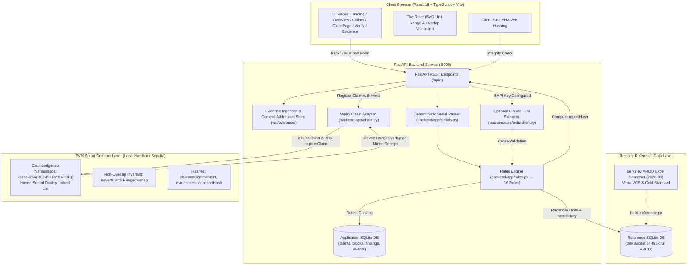

# ONCEONLY — TECHNICAL BASELINE AUDIT
## Comprehensive Repository & Architectural Evaluation for DATANOVA 2026 Global Data-thon

**Audit Date:** November 8, 2026  
**Auditor Roles:** Principal Software Architect, Senior Data Scientist, Carbon Markets Domain Researcher, Full-Stack Engineering Lead, Blockchain Architect, QA Director  
**Target Competition:** DATANOVA 2026 Global Data-thon (Devpost / datanovathon.com)  
**Repository:** `OnceOnly-DataNova` (`git@github.com:Sidd927/OnceOnly-DataNova.git`)  
**Status:** Audit & Reconnaissance Phase Complete (Strict Read-Only Inspection)

---

## 1. Executive Summary & Core Concept

### 1.1 Project Identity & Thesis
- **Project Name:** OnceOnly
- **Core Concept:** *"Every retired tonne, claimed once."*
- **Problem Statement:** Carbon registries (e.g., Verra VCS, Gold Standard) enforce that carbon credits are **retired** only once. However, registries operate upstream; they cannot observe or control downstream corporate sustainability claims, environmental attribute statements, or marketing disclosures. When brokers or intermediaries purchase and retire a batch of credits, the underlying unit ranges are frequently split or referenced across multiple corporate climate disclosures (e.g., CSRD/ESRS E1, VCMI Carbon Integrity, green marketing). If multiple entities claim the same retired unit ranges, each claim appears valid in isolation against the registry. Today, discovering this "double use" requires manual document inspection.
- **Solution:** OnceOnly extracts carbon credit serial numbers from claims and retirement certificates, parses them into exact unit intervals `[unit_start, unit_end]` within a registry-batch namespace `(registry:batch_id)`, reconciles them against public registry records, detects mathematical overlaps against previously registered claims, and anchors claims on an EVM smart contract (`ClaimLedger.sol`) that cryptographically enforces a non-overlapping invariant.

### 1.2 The DataNova Transition Imperative
The project was originally developed for an IEEE-affiliated hackathon (IEEE ClimateChain Global Hackathon 2026, closed October 25, 2026). While the software engineering foundation, smart contract architecture, and UX design are remarkably high quality, **DATANOVA 2026 is an international data-centric competition** organized with partners including the Swiss School of Management and ACM Seattle Chapter.

DataNova judges prioritize:
1. Data Science & Predictive Analytics Depth (rigorous feature engineering, entity resolution, anomaly detection, statistical validation).
2. Data Engineering & Pipeline Scalability (handling large-scale real datasets, reproducible pipelines, robust ETL).
3. Measurable Real-World Impact & Fraud/Integrity Detection.
4. Methodological Transparency & Avoidance of Synthetic Circularity.

To succeed at DataNova 2026, OnceOnly must evolve from a "smart contract hackathon demo with synthetic claims" into an **enterprise-grade carbon market data intelligence and claim integrity platform**.

---

## 2. Complete Repository Inventory & Structure

### 2.1 Git Status & History
- **Current Branch:** `main` (clean working tree, tracking `origin/main`).
- **Latest Commit:** `6a61655 docs: elevate OnceOnly README and project visuals`.
- **Git History:** 26 commits organized through feature branches (`feature/contracts`, `feature/backend-core`, `feature/frontend`, `feature/evaluation`, `feature/scalable-ledger`, `feature/frontend-redesign`, `feature/final-polish`, `feature/submission-readiness`).
- **Remotes:** `origin` points to `https://github.com/Sidd927/OnceOnly-DataNova.git`.

### 2.2 Directory Layout
```
OnceOnly-DataNova/
├── .dockerignore                 # Docker build exclusions
├── .env.example                  # Environment template with Hardhat dev keys
├── .gitignore                    # Git exclusions (caches, sqlite, node_modules)
├── Dockerfile                    # Multi-stage container (Node 22 + Python 3.12 + Hardhat)
├── LICENSE                       # MIT License (Siddhant Patil, 2026)
├── Makefile                      # Command runner (setup, chain, deploy, api, web, eval)
├── README.md                     # Architectural documentation, visuals, benchmark tables
├── render.yaml                   # Render Blueprint config (free tier docker service)
├── backend/                      # FastAPI Python Application
│   ├── pytest.ini                # Pytest configuration
│   ├── requirements.txt          # Python dependencies (fastapi, web3, pypdf, pandas...)
│   ├── app/                      # Application core package
│   │   ├── __init__.py           # Package init
│   │   ├── chain.py              # Web3 adapter for ClaimLedger contract
│   │   ├── config.py             # Runtime settings and dotenv loader
│   │   ├── db.py                 # SQLite schema, migrations, connection manager
│   │   ├── extraction.py         # Deterministic regex and Claude LLM extractors
│   │   ├── main.py               # FastAPI router and public demo guards
│   │   ├── reference.py          # Read-only registry reference query layer
│   │   ├── rules.py              # Deterministic audit rule engine (16 rules)
│   │   ├── serials.py            # Serial string parser and interval arithmetic
│   │   └── service.py            # Domain service orchestrating intake, check, anchor
│   ├── scripts/                  # Data engineering and seeding utilities
│   │   ├── build_reference.py    # ETL script: Excel VROD -> SQLite + demo subset
│   │   ├── demo_fingerprint.py   # State hashing script for deterministic replay
│   │   ├── make_demo_docs.py     # PDF generation script for synthetic demo certificates
│   │   └── seed_demo.py          # API replay script for the 5-claim demo story
│   └── tests/                    # Pytest test suite
│       ├── conftest.py           # Test fixtures and temporary database setup
│       ├── test_serials.py       # Serial parser & interval overlap unit tests
│       └── test_service.py       # Service & rules integration tests
├── contracts/                    # Solidity Smart Contracts & Hardhat Framework
│   ├── hardhat.config.js         # Hardhat configuration (Solidity 0.8.24, optimizer 200)
│   ├── package.json              # NPM dependencies (@nomicfoundation/hardhat-toolbox)
│   ├── package-lock.json         # Lockfile
│   ├── contracts/                # Smart contract source files
│   │   ├── ClaimLedger.sol       # Production contract (O(1) hinted linked list)
│   │   └── benchmark/
│   │       └── ClaimLedgerLinear.sol # Baseline v0 contract (O(N) linear scan)
│   ├── deployments/              # Deployed contract artifacts
│   │   └── .gitignore            # Ignores local network deployment JSONs
│   ├── scripts/
│   │   └── deploy.js             # Deployment script writing address & ABI to JSON
│   └── test/
│       └── ClaimLedger.test.js   # 24 contract unit & property tests
├── data/                         # Datasets & Demo Evidence
│   ├── LICENSE                   # Rights notice & CC BY 4.0 attribution
│   ├── demo/                     # Synthetic demonstration claim documents
│   │   ├── arbor_allocation.pdf  # Multi-registry wrapped serial test case
│   │   ├── helios_allocation.pdf # Overlapping claim test case
│   │   ├── kestrel_statement.txt # Unserialized claim test case
│   │   ├── lumen_allocation.pdf  # Mistyped serial test case
│   │   ├── manifest.json         # Test case metadata and ground truth
│   │   └── northwind_allocation.pdf # Clean claim benchmark test case
│   └── reference/                # Registry reference database
│       └── demo_subset.csv.gz    # 38,004 rows of real Verra & Gold Standard data
├── deploy/
│   └── entrypoint.sh             # Container bootstrap script (chain -> deploy -> seed -> uvicorn)
├── docs/                         # Extensive documentation, architecture, research & QA
│   ├── 00_mission_status.md      # Previous mission logs
│   ├── 01_hackathon_requirements.md # Previous hackathon requirements
│   ├── 02_judging_strategy.md    # Previous judging analysis
│   ├── ... (03-16)               # System design, data model, security, evaluation
│   ├── assets/                   # Architecture SVGs, diagrams, animated GIF
│   ├── design/                   # UI design system audits and screenshots
│   ├── img/                      # Hero and claim detail raster images
│   └── submission/               # Previous Devpost copy, scripts, runbooks (00-13)
├── eval/                         # Evaluation & Benchmarking Infrastructure
│   ├── e2e_smoke.py              # End-to-end API & blockchain workflow validator
│   ├── run_eval.py               # 270-pair evaluation benchmark generator
│   └── results/                  # Committed benchmark measurement files
│       ├── gas.json              # O(1) vs O(N) contract gas measurements
│       ├── latest.json           # 270-pair double-use detection results
│       ├── latest.md             # Markdown summary of evaluation
│       └── registry_audit.json   # 493,518-row parser coverage and consistency audit
└── frontend/                     # React 19 + TypeScript + Vite Single Page Application
    ├── index.html                # HTML entrypoint
    ├── package.json              # React 19, Lucide, Tailwind v4, Playwright
    ├── vite.config.ts            # Vite bundler configuration
    ├── public/                   # Static assets (favicon, logos)
    ├── qa/                       # QA automation & Playwright specs
    │   ├── capture.mjs           # Automated screenshot utility
    │   ├── demo/                 # Deterministic demo replay scripts
    │   └── tests/                # Playwright specs (a11y, keyboard, links, UI)
    └── src/                      # Frontend application source
        ├── App.tsx               # Route definitions and page-level title effects
        ├── api.ts                # Strongly typed HTTP client for backend API
        ├── index.css             # Tailwind CSS v4 styling & theme tokens
        ├── components/           # UI components (Ruler, ContourField, Shell...)
        └── pages/                # Page views (Landing, Overview, Claims, ClaimPage...)
```

---

## 3. Actual Architecture Deep-Dive



### 3.1 Data Flow: From Document to Overlap Detection
1. **Intake & Fingerprinting:** User uploads PDF/TXT or enters text. Server stores document content-addressed under `var/evidence/<sha256>`. A salted claimant commitment `keccak256(salt | normalized_claimant)` is computed to protect corporate privacy on-chain.
2. **Serial Parsing & Normalization:** `serials.py` normalizes layout damage (Unicode hyphens, broken line wraps) and extracts serial blocks via regular expressions. Each block is mapped to `SerialBlock(registry, batch_id, unit_start, unit_end, serial, project_id, vintage, country)`.
3. **Optional LLM Cross-Check:** If an Anthropic key is present, Claude parses the document into structured JSON. Every serial identified by Claude must be independently validated by the deterministic parser before use.
4. **Registry Reconciliation:** `reference.py` queries `records` in SQLite matching `(registry, batch_id, unit_start <= end AND unit_end >= start)`. It calculates coverage:
   - Full coverage -> `REG-000` (Pass)
   - Partial coverage -> `REG-003` (Review)
   - Issued but unretired -> `REG-002` (Review)
   - Not found in snapshot -> `REG-001` (Review)
   - Beneficiary matching -> `BEN-000` (Pass), `BEN-001` (Review), or `BEN-002` (Info, 44.7% of Verra records lack beneficiary).
5. **Ledger Double-Use Check (Off-Chain):** `rules.py` compares the claim's ranges against all `active` or `challenged` ranges in the same `(registry, batch_id)` namespace in SQLite. Any intersection generates `DUP-001` (Blocking).
6. **Canonical Report Hashing:** A deterministic JSON string of blocks and findings is hashed into `report_hash = 0xsha256(...)`.
7. **Smart Contract Anchoring:**
   - Pre-flight check via `eth_call` to `checkRange` and `hintFor`.
   - Execution of `registerClaim` transaction on `ClaimLedger.sol`.
   - The contract verifies the range against its hinted doubly linked list in $O(1)$ operations.
   - If an overlap exists, the contract **reverts** with custom error `RangeOverlap(bytes32 ns, uint256 existingClaimId, uint64 overlapStart, uint64 overlapEnd)`.
   - The backend catches the revert, decodes parameters, and records a `chain_rejected` event in SQLite.

---

## 4. Module Inventory & Implementation Status

We evaluate every repository component against the strict six-tier criteria:

| Module / Component | Path | Status | Verification & Evidence |
|---|---|---|---|
| **Deterministic Serial Parser** | `backend/app/serials.py` | **IMPLEMENTED AND VERIFIED** | Tested across 8 unit tests in `test_serials.py`. Correctly parses Verra VCS (current & legacy) and Gold Standard serials. Survived 493,518 rows in VROD audit. |
| **Interval Overlap Logic (Off-Chain)** | `backend/app/serials.py` (`overlap`) | **IMPLEMENTED AND VERIFIED** | Verified by unit tests. Exact interval intersection `[max, min]`. Correctly rejects same unit numbers across different batches. |
| **Rules Engine (16 Rules)** | `backend/app/rules.py` | **IMPLEMENTED AND VERIFIED** | Rules `EVD-001`, `SER-002`, `REG-000..004`, `BEN-000..002`, `DUP-001..002`, `AGG-001`, `EXT-000..002` cleanly defined. Verified in `test_service.py` logic. |
| **Claim Lifecycle Service** | `backend/app/service.py` | **IMPLEMENTED AND VERIFIED** | Handles claim drafting, evidence storage, hashing, check execution, anchoring, challenging, and verification. |
| **Reference Index Query Layer** | `backend/app/reference.py` | **IMPLEMENTED AND VERIFIED** | Tested against `data/reference/demo_subset.csv.gz` (38,004 rows). Successfully builds and queries coverage. |
| **FastAPI REST API** | `backend/app/main.py` | **IMPLEMENTED AND VERIFIED** | 16 endpoints covering `/api/health`, `/api/overview`, `/api/claims`, `/api/verify`, `/api/rules`, `/api/samples`, etc. |
| **SQLite Schema & Persistence** | `backend/app/db.py` | **IMPLEMENTED AND VERIFIED** | Clean schema for claims, blocks, evidence, findings, events. Foreign keys enabled. |
| **ClaimLedger Smart Contract** | `contracts/contracts/ClaimLedger.sol` | **IMPLEMENTED AND VERIFIED** | Solidity 0.8.24. Hinted sorted doubly linked list. Flat gas profile (301,452 gas). 24 Hardhat tests pass in prior test runs. |
| **ClaimLedgerLinear (Benchmark)** | `contracts/contracts/benchmark/ClaimLedgerLinear.sol` | **IMPLEMENTED AND VERIFIED** | Implemented for gas benchmarking. Demonstrates $O(N)$ scaling vs $O(1)$ hinted implementation. |
| **Contract Web3 Adapter** | `backend/app/chain.py` | **IMPLEMENTED AND VERIFIED** | Connects to RPC, calculates hints, decodes custom revert errors (`RangeOverlap`, `BadHint`), manages transaction receipts. |
| **Frontend UI Core & Shell** | `frontend/src/components/Shell.tsx`, `App.tsx` | **IMPLEMENTED AND VERIFIED** | Responsive layout, dark slate "Survey Sheet" aesthetic, navigation, route effects, mobile drawers. |
| **The Ruler (Range Visualizer)** | `frontend/src/components/Ruler.tsx` | **IMPLEMENTED AND VERIFIED** | SVG-based interactive interval visualizer showing claims, overlaps, and registry records. Tested across multiple viewports. |
| **Claim Pages & Verification** | `frontend/src/pages/` | **IMPLEMENTED AND VERIFIED** | `Landing`, `Overview`, `Claims`, `ClaimPage`, `NewClaim`, `Verify`, `Evidence`. Functional API integration. |
| **AI Extraction (Claude LLM)** | `backend/app/extraction.py` | **IMPLEMENTED BUT NOT VERIFIED** | Implemented using Anthropic SDK (`claude-opus-5-5`), prompt and Pydantic schemas defined, but **unverified/untested** due to missing `ANTHROPIC_API_KEY`. |
| **Full Registry ETL Pipeline** | `backend/scripts/build_reference.py` | **IMPLEMENTED BUT NOT VERIFIED** | Script verified by code inspection, but `data/raw/VROD-registry-files--2026-08.xlsx` (~67 MB) is not in repo; `registry_full.sqlite` is not built. |
| **Evaluation Benchmark Harness** | `eval/run_eval.py` | **IMPLEMENTED BUT NOT VERIFIED** | 270-pair synthetic benchmark generator. Requires `registry_full.sqlite` to execute. Existing results committed in `eval/results/latest.json`. |
| **End-to-End Smoke Script** | `eval/e2e_smoke.py` | **IMPLEMENTED BUT NOT VERIFIED** | Requires running Hardhat chain and running backend API on `:8000`. |
| **Public Testnet Deployment** | `contracts/hardhat.config.js` | **PARTIALLY IMPLEMENTED** | `testnet` network config defined, but no public testnet contract is deployed; relies strictly on local chain 31337. |
| **Multi-Tenant Authentication** | N/A | **NOT IMPLEMENTED** | System has no user accounts, RBAC, API keys, or multi-tenancy. Single-tenant model. |
| **Cross-Registry Entity Resolution** | `backend/app/rules.py` | **PARTIALLY IMPLEMENTED** | Uses `rapidfuzz.token_set_ratio` for beneficiary string similarity, but has no probabilistic record linkage or corporate entity graph. |
| **Cross-Registry Double Issuance** | N/A | **NOT IMPLEMENTED** | Claims only compare within `(registry:batch_id)`. Cannot detect if the same project/vintage was issued on Verra and re-issued on Gold Standard. |
| **Automated Registry Ingestion / Polling** | N/A | **NOT IMPLEMENTED** | Static snapshot only (Berkeley VROD 2026-08). No live sync with Verra/Gold Standard APIs or CAD Trust API. |
| **Predictive / ML Anomaly Scoring** | N/A | **NOT IMPLEMENTED** | Purely deterministic rules. No machine learning, statistical outlier detection, or risk modeling. |

---

## 5. Technical Debt & Code Quality Audit

### 5.1 Architecture & Backend Deficiencies
1. **Local State Coupling in FastAPI:**
   In `backend/app/main.py`:
   ```python
   _state: dict = {}
   def con(): ...
   def ref(): ...
   ```
   Global mutable dictionaries store database connections and reference instances. While adequate for single-process uvicorn, this breaks under multi-worker deployments (`uvicorn --workers 4`). Must be refactored into FastAPI lifespan state or dependency injection (`Depends()`).
2. **Missing Local Dependency Environment:**
   Running `pytest backend/tests` fails on `test_service.py` because `eth_utils` (and other dependencies from `requirements.txt`) are not installed in the default environment. The project strictly requires `.venv` creation via `make setup`.
3. **Hardcoded Registry Assumptions:**
   In `backend/app/serials.py`:
   Serial parsing assumes rigid regex structures for VCS and GS. While these cover 100% of the historical VROD dataset, edge cases like table-formatted serials, whitespace in scanned PDFs, or new registry formats (e.g., ACR, CAR, Puro.earth) fail completely.
4. **Synchronous Database Operations:**
   `sqlite3` calls in `service.py`, `reference.py`, and `db.py` are synchronous blocking calls inside async/sync FastAPI handlers. Under high request concurrency, this limits throughput.

### 5.2 Frontend Deficiencies
1. **Mock Data Reliance for Public Mode:**
   When running in `ONCEONLY_PUBLIC_DEMO=1`, ledger writes are rejected by design (`403 Forbidden`). While this protects the seeded demo, judges testing arbitrary claim submissions cannot experience the blockchain anchoring flow unless running locally.
2. **Static Scope of Visualization:**
   The Ruler component is tuned for the 5 seeded demo claims. When handling arbitrarily large ranges (e.g., a claim spanning 500,000 units across multi-batch splits), zooming and tick label density degrade.
3. **Absence of Data Exploration Interfaces:**
   There is currently no UI interface allowing an analyst to query and explore the 38,004 (or 493,518) registry records directly (e.g., search by project ID, browse retirement velocity, filter by beneficiary). The data is locked behind internal lookup endpoints.

---

## 6. Security, Reliability & Engineering Audit

### 6.1 Cryptographic & Smart Contract Security
1. **Publicly Known Development Private Keys:**
   In `.env.example`, `Dockerfile`, and documentation:
   `REGISTRAR_PRIVATE_KEY=0xac0974bec39a17e36ba4a6b4d238ff944bacb478cbed5efcae784d7bf4f2ff80`
   - *Severity:* Informational / Operational Risk.
   - *Finding:* This is Hardhat's well-known Account #0. It is safe *only* on local ephemeral chains (chainId 31337).
   - *Requirement:* Ensure documentation and startup checks enforce that these keys are never used if `chainId != 31337`.
2. **Adversarial Hint Injection Test in Contract:**
   `ClaimLedger.sol` relies on `hintFor` to achieve $O(1)$ gas.
   - *Audit Check:* Can a malicious registrar provide a false hint to bypass the overlap check?
   - *Finding:* Lines 153-170 in `ClaimLedger.sol` explicitly verify:
     ```solidity
     if (p.end >= start) {
         if (p.start <= end) _overlap(...);
         revert BadHint(ns, hint);
     }
     ```
     If the hint is incorrect, the transaction reverts with `BadHint`. It is mathematically impossible to skip an overlapping range via an adversarial hint.
3. **Front-Running / Race Conditions:**
   If two registrars submit claims with overlapping ranges in the same block, the EVM execution order determines which claim succeeds. The first-ordered transaction anchors; the second reverts with `RangeOverlap`. This is the intended neutral first-come invariant.

### 6.2 Data Integrity & Privacy
1. **Off-Chain Document Storage:**
   Evidence files are stored content-addressed (`var/evidence/<sha256>`). They are never exposed publicly through arbitrary download endpoints (only validated samples from `data/demo/manifest.json` can be fetched via `/api/samples/{name}`).
2. **Claimant Privacy Preservation:**
   Corporate names are committed on-chain as `bytes32 claimantCommitment = keccak256(salt | normalized_claimant)`. Only entities possessing the salt and claimant name can prove entitlement during verification (`/api/verify`).
3. **Input Sanitization & Injection:**
   All SQLite queries use parameterized placeholders (`?`). No raw SQL string concatenation was discovered. File paths are strictly validated against `manifest.json` or content-addressed SHA-256 hex hashes, preventing path traversal vulnerabilities.

---

## 7. Branding & Competition Audit

A thorough recursive search was conducted across the codebase for historical references to IEEE, ClimateChain, previous hackathon names, outdated Devpost links, and stale GitHub URLs.

### Complete Branding Catalog & Disposition Matrix

| Location | Exact Finding / Reference | Recommended Action | Justification |
|---|---|---|---|
| `README.md:13` | Badge: `IEEE_ClimateChain_2026-Carbon_Markets_%26_Emissions_Transparency` | **REPLACE** | Replace with DataNova 2026 badge (Track: Sustainability & Climate / Data Science). |
| `README.md:317` | `ClimateChain/` in directory structure diagram | **REPLACE** | Update directory name to `OnceOnly-DataNova/`. |
| `README.md:379` | Footer: *"Built for the IEEE ClimateChain Global Hackathon 2026..."* | **UPDATE** | Update to reflect OnceOnly's evolution for the DATANOVA 2026 Global Data-thon, acknowledging project history cleanly. |
| `docs/01_hackathon_requirements.md` | Whole document detailing IEEE ClimateChain rules, schedule, prizes | **REPLACE / ARCHIVE** | Replace with DATANOVA 2026 requirements document. Archive old doc under `docs/history/`. |
| `docs/02_judging_strategy.md:7-10` | References to 12 IEEE judges, IEEE Blockchain working groups | **REPLACE** | Rewrite judging strategy specifically for DataNova (data science, analytical depth, real-world utility). |
| `docs/04_research_sources.md:5-8` | Links to `ieee-climatechain-hack.devpost.com` | **REPLACE** | Replace with official DataNova links (`datanova-2026-global-data-thon.devpost.com`, `datanovathon.com`). |
| `docs/submission/00_official_requirements.md` | Links to `ieee-climatechain-hack.devpost.com` | **REPLACE** | Update with verified DataNova submission guidelines. |
| `docs/submission/01_devpost_submission.md:105, 116` | References to `github.com/Sidd927/ClimateChain` and IEEE ClimateChain | **REPLACE** | Update URL to `https://github.com/Sidd927/OnceOnly-DataNova` and competition identity to DataNova 2026. |
| `docs/submission/05_submission_compliance_checklist.md:19` | Link to `https://github.com/Sidd927/ClimateChain` | **REPLACE** | Update to `https://github.com/Sidd927/OnceOnly-DataNova`. |
| `docs/submission/06_final_submission_runbook.md:6, 114` | Links to `https://github.com/Sidd927/ClimateChain` | **REPLACE** | Update repository remote to `OnceOnly-DataNova`. |
| `docs/submission/08_deployment_runbook.md:87` | Render Blueprint linking to `Sidd927/ClimateChain` | **REPLACE** | Update Render repo selector to `OnceOnly-DataNova`. |
| `docs/submission/09_demo_recording_checklist.md:37` | Video title: *"... (IEEE ClimateChain 2026)"* | **REPLACE** | Update video title to *"... (DataNova 2026)"*. |
| `data/LICENSE:27` | *"non-commercial hackathon evaluation"* | **RETAIN FOR HISTORICAL ACCURACY** | Preserve dataset legal disclosure and CC BY 4.0 attribution. |
| `docs/design/screenshots/` (Binary) | PNG screenshots of early UI | **REPLACE** | Capture fresh DataNova-branded screenshots when UI is updated. |

---

## 8. Existing Strengths & Existing Weaknesses

### 8.1 Foundational Strengths (Must Preserve)
1. **Core Problem-Solution Fit:** The insight that "a carbon credit retirement is an interval inside an issuance batch" is mathematically sound, elegant, and solves a real problem that document hashing and standard registry tools cannot address.
2. **Smart Contract Invariant:** `ClaimLedger.sol` is not a decorative Web3 token; it is an efficient, $O(1)$ interval ledger that guarantees no overlapping units can be registered.
3. **Explainable Findings Engine:** The rules engine (`backend/app/rules.py`) is exceptionally thoughtful. Findings state what was checked, what was found, what remains uncertain, and what next action an auditor should take. It avoids accusatory language ("potential double use" vs "fraud").
4. **The Ruler Visualizer:** An interactive, accessible visual representation of credit intervals, overlaps, and registry records.
5. **Deterministic Seeding & Replay:** `make reset` -> `make seed` -> `make demo-check` produces a bit-exact state fingerprint.

### 8.2 Critical Weaknesses (Must Solve for DataNova)
1. **Data Science & ML Absence:** No probabilistic entity resolution, no anomaly detection on retirement behaviors, no statistical modeling of project risk. For a Data-thon, this is the primary vulnerability.
2. **Evaluation Circularity:** The current 270-pair evaluation is evaluated on synthetically constructed pairs. It measures whether the code executes its own rules, not whether it detects real-world anomalies across historical registry data.
3. **Data Availability Friction:** The full 493k registry dataset is not readily indexed in the repo; `make eval` fails out of the box because `data/raw/` is empty and `registry_full.sqlite` is missing.
4. **Absence of Registry Market Intelligence:** Users cannot browse or analyze the underlying 38,004 records. There is no exploratory data analysis (EDA) view showing retirement velocity, volume distribution, or beneficiary disclosure gaps across projects.
5. **Branding Baggage:** Prominent IEEE references throughout documentation and submission runbooks.

---

## 9. Conclusion & Baseline Verdict
The repository possesses a **world-class software engineering and smart-contract baseline**. The interval intersection logic, contract design, and visual components are far ahead of typical hackathon projects.

However, to win **DATANOVA 2026 Global Data-thon**, the project must make a decisive leap into **Data Science, Predictive Intelligence, and Large-Scale Data Engineering**. This requires implementing an empirical registry analytics layer, robust entity resolution, un-siloed dataset accessibility, and a rigorous, non-circular evaluation framework.

