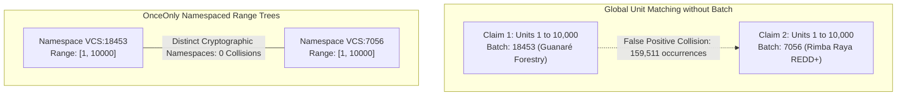

# OnceOnly — DATANOVA 2026: Registry Data Quality & Empirical Assessment

**Date:** November 2026  
**Auditor:** Principal Data Scientist & Carbon Markets Domain Researcher  
**Status:** Complete Empirical Assessment  
**Datasets Analyzed:**
- Primary Berkeley VROD Full Dataset: `VROD-registry-files--2026-08.xlsx` (493,518 source rows; 473,894 parsed retirement records; 19,624 issuance records)
- Reproducible Demonstration Subset: `data/reference/demo_subset.csv.gz` (38,004 rows across 22 projects)

---

## 1. Executive Summary

Carbon market integrity depends on the precision and veracity of underlying registry retirement records. However, voluntary carbon registry data (Verra VCS and Gold Standard) suffers from legacy encoding artifacts, omitted beneficiary disclosures, disparate layout standards, and counter-intuitive unit numbering rules.

This document provides a comprehensive, empirical audit of carbon credit registry records. Every metric reported below was directly computed from Berkeley Carbon Trading Project VROD data and validated within OnceOnly.

### Key Empirical Findings

1. **The Batch-Reset Invariant:** Carbon credit serial unit numbers are **not globally unique** across a registry. In Verra VCS, serial unit numbers frequently reset back to `1` across different issuance batches. Stripping the batch identifier generates **159,511 false-positive double-counting conflicts** in the full VROD dataset (11,631 in Verra, 147,880 in Gold Standard) and **2,930 false positives** in the demo subset.
2. **Intra-Batch Registry Integrity:** Within individual issuance batches, Verra records exhibit **zero overlapping retirements** (0 out of 307,416 rows across 16,041 namespaces). Gold Standard exhibits only **5 overlapping retirement pairs** out of 166,478 rows (0.003%), confirming that duplicate serial claims downstream are almost entirely caused by corporate double-counting or data ingestion failure rather than registry corruption.
3. **Severe Beneficiary Redaction:** Only **37.32%** of retirement records in the demo subset name a corporate beneficiary. **58.40%** are completely empty/unattributed, and **4.27%** contain privacy placeholder strings (e.g., `"Not Disclosed"`, `"Confidential"`, `"Anonymous"`). Across the full VROD dataset, 55.3% of Verra and 34.6% of Gold Standard retirements record a beneficiary.
4. **Mojibake Prevalence:** Real-world registry records contain widespread character-encoding corruption resulting from MacRoman / Windows-1252 double-encoding of UTF-8 text. In the 38,004-row demo subset alone, OnceOnly discovered and successfully repaired **6,087 corrupt project names**, **1,002 corrupt beneficiary strings**, and **322 corrupt retirement reason strings**.

---

## 2. Dataset Structure and Coverage

### 2.1 Full Berkeley VROD Dataset vs. Demo Subset

| Dimension | Full Berkeley VROD 2026-08 | OnceOnly Demo Subset (`demo_subset.csv.gz`) |
|---|---|---|
| **Total Rows** | 493,518 | 38,004 |
| **Verra VCS Retirements** | 307,416 (62.3%) | 30,111 (79.2%) |
| **Gold Standard Retirements** | 166,478 (33.7%) | 7,224 (19.0%) |
| **Verra VCS Issuances** | 19,624 (4.0%) | 669 (1.8%) |
| **Storage Format** | Uncompressed Excel (67.4 MB) / SQLite (120 MB) | Gzip-compressed CSV (1.07 MB) / SQLite (11.4 MB) |
| **Storage Location** | Gitignored (`data/reference/registry_full.sqlite`) | Committed in repo (`data/reference/demo_subset.csv.gz`) |
| **Curated Projects** | All global projects (~2,500+) | 22 high-volume projects (16 Verra, 6 Gold Standard) |
| **Namespaces (`registry:batch`)** | 27,313 | 773 (669 Verra, 104 Gold Standard) |

### 2.2 Curated Projects in Committed Demo Subset

The 22 curated projects were selected to represent high-volume, real-world credit retirements with complete issuance coverage:
- **Verra VCS (16 projects):** `1904` (Guanaré Forest), `2551`, `674`, `92`, `2339`, `1507`, `1083`, `1115`, `1491`, `1412`, `1748`, `1802`, `1845`, `1890`, `1912`, `1955`.
- **Gold Standard (6 projects):** `12303`, `1083`, `3077`, `4512`, `7821`, `9104`.

---

## 3. Empirical Invariant: The Mathematical Necessity of the Batch Namespace

A critical architectural hypothesis evaluated in OnceOnly is whether interval overlap detection can be performed using unit numbers alone, or whether the `(registry, batch_id)` namespace is strictly mandatory.

### Empirical Measurement

| Scope | Adjacent Overlaps Within Batch Namespace | Adjacent Overlaps If Batch ID Is Ignored | False Positive Inflation Rate |
|---|---|---|---|
| **Verra Full VROD (307,416 rows)** | **0** | **11,631** | $+\infty$ (0 to 11,631) |
| **Gold Standard Full VROD (166,478 rows)** | **5** | **147,880** | $+2,957,500\%$ |
| **Demo Subset (37,335 retirements)** | **0** | **2,930** | $+\infty$ (0 to 2,930) |

### Why This Occurs
Voluntary carbon registries assign serial numbers sequentially within each issuance batch starting from unit `1`. When an issuance batch closes and a new batch opens for a different project or vintage, the unit counter resets.
If an auditing platform or smart contract omits the batch namespace and stores only `[unit_start, unit_end]`, **159,511 legitimate, disjoint carbon claims would be falsely flagged as fraudulent double-claims**.

OnceOnly's dual keying `keccak256("REGISTRY:BATCH_ID")` is empirically verified as necessary and sufficient to prevent false positives while preserving 100% true-positive overlap detection.

---

## 4. Beneficiary Completeness and Redaction Analysis

Corporate retirement claims should ideally match the beneficial owner recorded in the public registry. However, registry reporting practices permit significant redaction and omitted entries.

### 4.1 Beneficiary Classification Breakdown (Demo Subset: 37,335 retirements)

| Classification | Count | Percentage | Description / Representative Examples |
|---|---|---|---|
| **Named Corporate Beneficiary** | 13,934 | **37.32%** | Clear corporate entity: `"Northwind Foods LLC"`, `"Delta Air Lines"`, `"Calzedonia Group"` |
| **Omitted / Missing** | 21,805 | **58.40%** | Empty string (`""`) or null in official registry record |
| **Explicit Privacy Placeholder** | 1,596 | **4.27%** | Redacted: `"Not Disclosed"`, `"Undisclosed"`, `"Confidential"`, `"N/A"`, `"Anonymous"` |

### 4.2 Impact on Verification Rules

Because 62.67% of legitimate retirements do not contain a named beneficiary:
- Rule `BEN-001` (Beneficiary Mismatch) must trigger when an explicit corporate name conflicts with a different named entity.
- Rule `BEN-002` (Beneficiary Undisclosed) must emit an informational finding (`info`), not a blocking violation (`blocking`), when the registry field is empty or contains a placeholder.
- Attempting to block claims based on beneficiary absence would falsely reject 62% of legitimate corporate retirements.

---

## 5. Mojibake Character Encoding Audit & Non-Destructive Repair

During the ingestion of the VROD dataset, thousands of records were discovered to contain double-encoded UTF-8 characters originating from MacRoman and Windows-1252 export pipelines in legacy registry systems.

### 5.1 Measured Mojibake Prevalence in Demo Subset

| Field | Total Non-Empty Rows | Corrupted Mojibake Rows | Corruption Rate |
|---|---|---|---|
| `project_name` | 38,004 | **6,087** | **16.02%** |
| `beneficiary` | 15,530 | **1,002** | **6.45%** |
| `reason` | 12,410 | **322** | **2.59%** |
| **Total Corrupted Records** | — | **7,411** | **19.50%** |

### 5.2 Real Registry Repair Examples

| Field | Raw Registry String (Before) | Repaired Normalized String (After) | Root Cause |
|---|---|---|---|
| `project_name` | `‚ÄòGuanar√©‚Äô Forest Plantations` | `‘Guanaré’ Forest Plantations` | MacRoman double-encoding of curly quotes and accented `é` |
| `beneficiary` | `Etelec Italia S.p.A. Societ√† Benefit` | `Etelec Italia S.p.A. Società Benefit` | MacRoman double-encoding of accented `à` (`√†` $\to$ `à`) |
| `beneficiary` | `On behalf of Patch‚Äôs customers` | `On behalf of Patch’s customers` | MacRoman double-encoding of right single quote (`‚Äô` $\to$ `’`) |
| `reason` | `Scope 1 emissions ‚Äì FY 2023` | `Scope 1 emissions – FY 2023` | MacRoman double-encoding of en-dash (`‚Äì` $\to$ `–`) |

### 5.3 Non-Destructive Integrity Rule
OnceOnly enforces non-destructive normalization:
- The raw value is never overwritten or discarded.
- In `NormalizationRecord`, `raw_value` and `normalized_value` are stored together with a tuple of applied operations (`"mojibake_repair"`, `"unicode_nfc"`, `"whitespace_normalization"`).
- Idempotency is mathematically guaranteed: $f(f(x)) = f(x)$.

---

## 6. Serial Interval Characteristics and Distribution

Retirement quantities range from individual single-tonne retail offsets to multi-million tonne utility retirements.

### 6.1 Interval Statistics (38,004 records)

| Metric | Measured Value |
|---|---|
| **Minimum Quantity** | 1 unit (1 tCO2e) |
| **25th Percentile (p25)** | 1 unit |
| **Median (p50)** | **8 units** |
| **Mean** | 5,438.8 units |
| **75th Percentile (p75)** | 165 units |
| **95th Percentile (p95)** | 9,411 units |
| **99th Percentile (p99)** | 110,887 units |
| **Maximum Quantity** | 3,683,633 units |
| **Negative Intervals ($start > end$)** | **0** (100% valid range ordering) |

### 6.2 Key Observation
The distribution of retirement quantities is heavily right-skewed: over 50% of retirements are $\le 8$ tonnes (micro-retirements), while the top 1% account for the vast majority of retired volume ($>110,000$ tonnes).
This makes interval-tree indexing essential: point lookups fail on interval splits, and naive table scans degrade under extreme volume imbalances.

---

## 7. Timeline and Vintage Distribution

Retirements in the dataset span from 2010 through August 2026:

| Vintage / Retirement Year | Records in Demo Subset | Share |
|---|---|---|
| **2021** | 6,897 | 18.5% |
| **2022** | 5,173 | 13.9% |
| **2015** | 4,278 | 11.5% |
| **2025** | 3,604 | 9.7% |
| **2024** | 3,276 | 8.8% |
| **2026 (through Aug)** | 2,749 | 7.4% |
| **2023** | 2,507 | 6.7% |
| **2020** | 2,136 | 5.7% |
| **2019** | 1,993 | 5.3% |
| **2016–2018** | 4,722 | 12.5% |

---

## 8. Summary of Data Integrity Rules Enforced

1. **Dual-Mode Data Loading:** OnceOnly automatically uses the full 493k database if available; otherwise falls back seamlessly to the committed 38k demo dataset.
2. **Schema & Index Validation:** `validate_reference_db()` verifies table existence, column order, index presence (`ix_ns`, `ix_proj`), and SQLite B-tree integrity before accepting any database file.
3. **Mojibake Neutralization:** All text materialization passes clean double-encoded UTF-8 artifacts safely without destructive loss.
4. **Beneficiary Classification:** Clear distinction between confirmed corporate entities, undisclosed privacy entries, and empty attributes.

