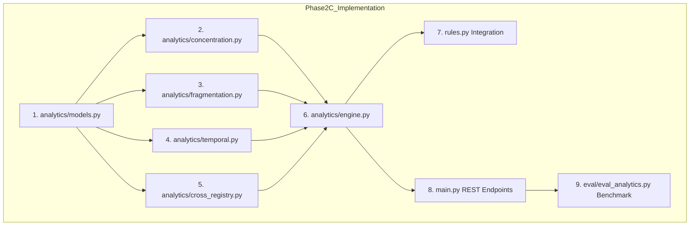

# ONCEONLY — DATANOVA 2026
# PHASE 2C: IMPLEMENTATION BLUEPRINT — STATISTICAL & TEMPORAL INTELLIGENCE

**Project:** OnceOnly — Carbon Market Integrity Platform  
**Target Competition:** DATANOVA 2026 Global Data-thon  
**Document Type:** Technical Architecture & Implementation Blueprint  
**Status:** Audit & Pre-Implementation Planning (Phase 2C Stage 1)  
**Author:** Principal Data Scientist, Senior Backend Architect & Technical Auditor  
**Date:** 2026-11-09  
**Active Branch:** `datanova/phase-0-baseline`

---

## 1. Executive Summary & Architectural Scope

Phase 2C extends OnceOnly from deterministic, single-interval duplicate detection (Phase 2B) to **population-level statistical, structural, and temporal intelligence**. While Phase 2B rigorously detects serial interval collisions, real-world carbon market integrity risks often manifest prior to or alongside interval overlap:
1. **Cartel & Monopoly Cornering:** Unreported or high-concentration retirement of strategic project batches by dominant corporate entities.
2. **Micro-Claim Evasion & Smurfing:** Systematic fragmentation of large retirement batches into hundreds of small claims (<10 t) across shell entities to evade corporate reporting thresholds.
3. **Temporal Dumping & Rapid Liquidation:** Abrupt liquidation of multi-year vintage batches within days of issuance, signaling distress selling, regulatory arbitrage, or unverified claims.
4. **Cross-Registry Duplication Risk:** Correlated project credentials and overlapping issuance across voluntary registries (Verra VCS and Gold Standard) under differing serial namespaces.

This blueprint specifies the exact modular architecture, Pydantic schemas, algorithmic implementations, SQLite indexing, REST API contracts, and rules engine integration required to implement Phase 2C under `backend/app/analytics/` with zero external dependencies and 100% offline reproducibility.

---

## 2. Target File Structure & Module Organization

The Phase 2C analytics subsystem will be housed entirely within `backend/app/analytics/`:

```
backend/app/analytics/
├── __init__.py                # Package export interface
├── models.py                  # Pydantic v2 schemas for all analytical models
├── concentration.py           # Pure mathematical functions: Shannon Entropy, HHI, Dual-Track Coverage
├── fragmentation.py           # Pure mathematical functions: Gini coefficient, distribution, micro-claims
├── temporal.py                # Pure temporal functions: Velocity, burn-rate, vintage lag, burst flags
├── cross_registry.py          # Cross-registry project & entity correlation (Serial Isolation Invariant)
└── engine.py                  # BatchAnalyticsEngine: SQLite querying, aggregation, rules integration
```

### Module Responsibilities & Design Invariants
1. **Functional Core, Imperative Shell:**
   `concentration.py`, `fragmentation.py`, `temporal.py`, and `cross_registry.py` contain **pure, deterministic functions** operating on primitives and typed sequences. They perform zero I/O, maintain zero state, and have zero database dependencies.
2. **Engine Layer:**
   `engine.py` orchestrates SQLite data extraction, query optimization, input validation, and assembling composite metrics into `BatchAnalyticsResult`.
3. **Serial Isolation Invariant:**
   `cross_registry.py` operates strictly across project titles, developer names, locations, and vintages. Numerical serials from distinct registries (e.g. Verra vs Gold Standard) are **never compared or equated**.
4. **Dual-Track Concentration Invariant:**
   Unidentified/undisclosed beneficiaries (holding `NULL`, `"Not Disclosed"`, or `"Undisclosed"`) are tracked as an explicit aggregate category (`unresolved_share` = 59.70% of retirement volume; 62.66% of retirement records) and never pooled as a single fictitious monopoly claimant. The system strictly separates **record-count disclosure rate (37.34%)** from **quantity-weighted beneficiary coverage (40.30%)**, computing HHI and Shannon entropy exclusively as conditional metrics over disclosed volume.
5. **Correlation vs Duplicate Claim Invariant:**
   Cross-registry project correlation identifies potential dual-registration risk, but does not conclude duplicate credit issuance, as registry serial spaces are disjoint.

---

## 3. Data Models Specification (`backend/app/analytics/models.py`)

All models adhere to Pydantic v2 and FastAPI serializability standards.

```python
"""Phase 2C Statistical and Temporal Analytics Data Models."""
from __future__ import annotations

from datetime import date, datetime
from typing import Dict, List, Optional
from pydantic import BaseModel, Field, ConfigDict, model_validator


class ConcentrationMetrics(BaseModel):
    """Dual-track beneficiary concentration and diversity metrics."""
    model_config = ConfigDict(frozen=True)

    total_units: float = Field(..., ge=0, description="Total units analyzed across batch")
    disclosed_units: float = Field(..., ge=0, description="Total units with identified beneficiaries")
    unresolved_units: float = Field(..., ge=0, description="Units with missing or undisclosed beneficiaries")
    beneficiary_coverage_ratio: float = Field(..., ge=0.0, le=1.0, description="Disclosed units / total units")
    unresolved_share: float = Field(..., ge=0.0, le=1.0, description="Unresolved units / total units")
    
    unique_disclosed_beneficiaries: int = Field(..., ge=0, description="Count of distinct disclosed entities")
    hhi_disclosed: float = Field(..., ge=0.0, le=10000.0, description="Herfindahl-Hirschman Index [0, 10000]")
    hhi_normalized: float = Field(..., ge=0.0, le=1.0, description="Normalized HHI [0.0, 1.0]")
    entropy_shannon_disclosed: float = Field(..., ge=0.0, description="Shannon entropy in bits (base-2)")
    entropy_normalized: float = Field(..., ge=0.0, le=1.0, description="Shannon equitability index [0.0, 1.0]")
    
    dominant_disclosed_beneficiary: Optional[str] = Field(None, description="Entity with highest disclosed volume")
    dominant_disclosed_share: float = Field(0.0, ge=0.0, le=1.0, description="Market share of dominant disclosed entity")
    disclosed_shares: Dict[str, float] = Field(default_factory=dict, description="Share per disclosed beneficiary")


class FragmentationMetrics(BaseModel):
    """Batch sizing, dispersion, Gini inequality, and micro-claim metrics."""
    model_config = ConfigDict(frozen=True)

    total_events: int = Field(..., ge=0, description="Number of retirement events in batch")
    total_units: float = Field(..., ge=0, description="Sum of retired units")
    
    gini_coefficient: float = Field(..., ge=0.0, le=1.0, description="Standard sample Gini coefficient [0.0, 1.0]")
    gini_sample_corrected: float = Field(..., ge=0.0, le=1.0, description="Finite-sample corrected Gini [0.0, 1.0]")
    
    mean_event_size: float = Field(..., ge=0.0, description="Arithmetic mean volume per event")
    median_event_size: float = Field(..., ge=0.0, description="Median volume per event")
    min_event_size: float = Field(..., ge=0.0, description="Minimum single event volume")
    max_event_size: float = Field(..., ge=0.0, description="Maximum single event volume")
    p25_event_size: float = Field(..., ge=0.0, description="25th percentile event volume")
    p75_event_size: float = Field(..., ge=0.0, description="75th percentile event volume")
    
    micro_claim_count: int = Field(..., ge=0, description="Count of micro-claim events")
    micro_claim_units: float = Field(..., ge=0.0, description="Total units retired in micro-claims")
    micro_claim_share: float = Field(..., ge=0.0, le=1.0, description="Micro-claim volume / total volume")
    micro_claim_threshold_used: float = Field(..., ge=0.0, description="Absolute cutoff used (e.g. 10.0 tonnes)")


class TemporalMetrics(BaseModel):
    """Retirement velocity, vintage dormancy, and liquidation burst metrics."""
    model_config = ConfigDict(frozen=True)

    first_event_date: Optional[date] = Field(None, description="Earliest retirement event date")
    last_event_date: Optional[date] = Field(None, description="Latest retirement event date")
    timespan_days: int = Field(..., ge=0, description="Calendar days between first and last event (inclusive: >= 1 if events exist)")
    
    total_volume: float = Field(..., ge=0.0, description="Total volume retired")
    burn_rate_tonnes_per_day: float = Field(..., ge=0.0, description="Average retirement velocity (tonnes/day)")
    peak_daily_volume: float = Field(..., ge=0.0, description="Max volume retired on a single calendar day")
    peak_event_date: Optional[date] = Field(None, description="Date of peak retirement activity")
    
    vintage_year: Optional[int] = Field(None, description="Batch vintage year")
    mean_vintage_lag_days: Optional[float] = Field(None, description="Mean days from vintage base (Jan 1) to event date")
    median_vintage_lag_days: Optional[float] = Field(None, description="Median days from vintage base to event date")
    min_vintage_lag_days: Optional[int] = Field(None, description="Minimum vintage lag in days")
    max_vintage_lag_days: Optional[int] = Field(None, description="Maximum vintage lag in days")
    
    liquidation_burst_flag: bool = Field(False, description="True if batch experienced anomalous burst liquidation")
    fiscal_quarter_clustering_share: float = Field(..., ge=0.0, le=1.0, description="Max share of volume in single calendar quarter")
    dominant_quarter: Optional[str] = Field(None, description="Calendar quarter with highest volume (e.g. '2022-Q4')")


class CrossRegistryMatch(BaseModel):
    """Similarity and duplicate issuance risk indicators between registries."""
    model_config = ConfigDict(frozen=True)

    registry_a: str = Field(..., description="First registry identifier (e.g. 'VCS')")
    project_id_a: str = Field(..., description="Project ID in registry A")
    project_name_a: str = Field(..., description="Project name in registry A")
    
    registry_b: str = Field(..., description="Second registry identifier (e.g. 'GS')")
    project_id_b: str = Field(..., description="Project ID in registry B")
    project_name_b: str = Field(..., description="Project name in registry B")
    
    project_name_similarity: float = Field(..., ge=0.0, le=1.0, description="Composite token and string similarity")
    country_match: bool = Field(..., description="True if country codes match exactly")
    developer_similarity: float = Field(..., ge=0.0, le=1.0, description="Similarity between project developers/proponents")
    vintage_overlap: bool = Field(..., description="True if project vintage spans intersect")
    
    composite_confidence: float = Field(..., ge=0.0, le=1.0, description="Overall cross-registry identity confidence [0, 1]")
    potential_duplicate_risk: bool = Field(..., description="Flag indicating potential dual-registry listing risk")


class BatchAnalyticsResult(BaseModel):
    """Unified container for all statistical, temporal, and risk analytics for a batch."""
    registry: str
    batch_id: str
    project_id: Optional[str] = None
    project_name: Optional[str] = None
    total_quantity: float
    total_events: int
    
    concentration: ConcentrationMetrics
    fragmentation: FragmentationMetrics
    temporal: TemporalMetrics
    cross_registry_alerts: List[CrossRegistryMatch] = Field(default_factory=list)
    risk_flags: List[str] = Field(default_factory=list)
    
    computed_at: datetime = Field(default_factory=datetime.utcnow)


class BatchAnalyticsRequest(BaseModel):
    """Input payload for ad-hoc batch analytics without database lookup."""
    registry: str = "ADHOC"
    batch_id: str = "ADHOC-BATCH"
    vintage: Optional[int] = None
    events: List[Dict[str, Any]] = Field(..., min_length=1, description="List of event dicts with quantity, beneficiary, event_date")

    @model_validator(mode="after")
    def validate_events(self) -> BatchAnalyticsRequest:
        for idx, ev in enumerate(self.events):
            if "quantity" not in ev or float(ev["quantity"]) < 0:
                raise ValueError(f"Event at index {idx} must have non-negative quantity")
        return self
```

---

## 4. Algorithmic Modules Implementation Specification

### 4.1 Concentration & Diversity (`concentration.py`)
- **Key Equations:**
  - $p_i = \frac{q_i}{\sum_{j=1}^m q_j}$ for $i \in \{1, \dots, m\}$ where $q_i > 0$ and beneficiary is disclosed.
  - $\text{HHI}_{\text{disclosed}} = \sum_{i=1}^m (100 \cdot p_i)^2$.
  - $\text{HHI}^* = \frac{\text{HHI}_{\text{disclosed}} - 10000/m}{10000 - 10000/m}$ for $m > 1$; $\text{HHI}^* = 1.0$ if $m=1$.
  - $H(P) = - \sum_{i=1}^m p_i \log_2(p_i)$.
  - $H_{\text{norm}} = \frac{H(P)}{\log_2(m)}$ for $m > 1$; $H_{\text{norm}} = 1.0$ if $m=1$.
  - Coverage: $C = \frac{\sum_{i=1}^m q_i}{Q_{\text{total}}}$, Unresolved: $U = \frac{Q_{\text{unresolved}}}{Q_{\text{total}}}$.
- **Boundary Handling:**
  - If $Q_{\text{total}} == 0$: return zeros, coverage = 0.0, unresolved = 0.0.
  - If $m == 0$ (all undisclosed): $\text{HHI}_{\text{disclosed}} = 0.0$, $H(P) = 0.0$, coverage = 0.0, unresolved = 1.0.

### 4.2 Sizing, Inequality & Fragmentation (`fragmentation.py`)
- **Key Equations:**
  - Standard Gini on sorted positive quantities $y_1 \le y_2 \le \dots \le y_n$:
    $$G = \frac{2 \sum_{i=1}^n i \cdot y_i}{n \sum_{i=1}^n y_i} - \frac{n + 1}{n}$$
  - Corrected Gini: $G^* = \frac{n}{n - 1} G$ for $n > 1$; $0.0$ if $n \le 1$.
  - Micro-claims: $y_i \le \theta_{\text{micro}}$, where $\theta_{\text{micro}} = 10.0$ tonnes.
  - Percentiles: Standard percentile calculation using linear interpolation between closest ranks.
- **Complexity:** $O(n \log n)$ time due to sort, $O(n)$ space.

### 4.3 Temporal Velocity & Vintage Dynamics (`temporal.py`)
- **Key Calculations:**
  - Date normalization: parse ISO strings (`YYYY-MM-DD`) into `datetime.date`.
  - Span: $\Delta T = (\text{last\_date} - \text{first\_date}).\text{days} + 1$.
  - Burn-rate: $\mathcal{V} = \frac{Q_{\text{total}}}{\Delta T}$ (tonnes/day).
  - Peak daily volume: Aggregate by calendar date $\sum_{d} q_d$, find $\max_d$.
  - Vintage lag: For each event date $D_i$ and vintage year $V$, $\text{lag}_i = (D_i - \text{date}(V, 1, 1)).\text{days}$.
  - Liquidation burst flag: Set `True` if:
    - $\Delta T \le 7$ days AND $Q_{\text{total}} \ge 1,000$ tonnes AND $n \ge 3$; OR
    - Peak single-day volume accounts for $> 70\%$ of total volume in a batch with $Q_{\text{total}} \ge 1,000$ tonnes.
  - Quarterly clustering: Determine quarter string `f"{d.year}-Q{(d.month-1)//3 + 1}"`, find maximum quarter volume share.

### 4.4 Cross-Registry Correlation (`cross_registry.py`)
- **Key Calculations:**
  - Token Sort Ratio & Jaro-Winkler between normalized project names:
    $$\text{Sim}_{\text{name}} = 0.6 \cdot \text{TokenSortRatio}(A, B) + 0.4 \cdot \text{JaroWinkler}(A, B)$$
  - Country check: $\mathbb{I}_{\text{country}} = 1.0$ if $C_A == C_B$ else $0.0$.
  - Developer similarity: Using Phase 2A `EntityResolutionEngine.resolve()` or token similarity.
  - Vintage overlap: $\mathbb{I}_{\text{vintage}} = 1.0$ if $|V_A - V_B| \le 1$.
  - Composite confidence:
    $$S_{\text{composite}} = 0.50 \cdot \text{Sim}_{\text{name}} + 0.20 \cdot \mathbb{I}_{\text{country}} + 0.20 \cdot \text{Sim}_{\text{dev}} + 0.10 \cdot \mathbb{I}_{\text{vintage}}$$
  - Flag risk if $S_{\text{composite}} \ge 0.85$ and $\text{registry}_A \ne \text{registry}_B$.

---

## 5. Storage & Query Optimization (`engine.py` & SQLite)

### 5.1 Database Indexing Invariant
The reference database `var/registry_demo.sqlite` contains the `records` table with 37,335 retirement records. To support sub-millisecond analytical aggregations, the engine leverages existing or creates necessary SQLite indexes:
```sql
CREATE INDEX IF NOT EXISTS idx_records_registry_batch ON records(registry, batch_id);
CREATE INDEX IF NOT EXISTS idx_records_project_country ON records(project_id, country);
```

### 5.2 SQLite Query Execution
Querying a batch executes a single structured SQL query:
```sql
SELECT 
    quantity, 
    beneficiary, 
    event_date, 
    vintage, 
    project_id, 
    project_name, 
    country
FROM records 
WHERE registry = ? AND batch_id = ? AND kind = 'retirement'
ORDER BY event_date ASC;
```
For cross-registry project matching, projects are queried grouped by `project_id`, `project_name`, `country`, and min/max vintage:
```sql
SELECT 
    registry, 
    project_id, 
    project_name, 
    country, 
    MIN(vintage) as min_vintage, 
    MAX(vintage) as max_vintage
FROM records 
GROUP BY registry, project_id, country;
```

---

## 6. Integration with Rules Engine (`backend/app/rules.py`)

Phase 2C analytics feeds directly into the compliance and risk assessment rules. Four new deterministic rules are introduced to `backend/app/rules.py`:

| Rule ID | Severity | Trigger Condition | Rule Name | Description |
| :--- | :--- | :--- | :--- | :--- |
| `RULE_STAT_001` | `WARNING` | $\text{HHI}_{\text{disclosed}} \ge 5000$ AND $C \ge 0.50$ AND $m \ge 2$ | `HIGH_BENEFICIARY_CONCENTRATION` | A single entity controls over 70% of disclosed batch claims. |
| `RULE_STAT_002` | `WARNING` | $\text{Share}_{\text{micro}} \ge 0.40$ AND $G \ge 0.60$ AND $n \ge 10$ | `ANOMALOUS_MICRO_CLAIM_FRAGMENTATION` | Batch is heavily fragmented into micro-claims (<10 t), indicating evasion risk. |
| `RULE_STAT_003` | `WARNING` | $\text{burst\_flag} == \text{True}$ AND $\mathcal{V} \ge 5000\text{ t/d}$ | `RAPID_LIQUIDATION_BURST` | Batch experienced abrupt liquidation in $\le 7$ days. |
| `RULE_STAT_004` | `CRITICAL` | $S_{\text{composite}} \ge 0.85$ between VCS and GS | `CROSS_REGISTRY_DUPLICATE_RISK` | Identical project parameters registered under distinct registry namespaces. |

---

## 7. REST API Endpoints Specification

Three high-performance REST endpoints are added to `backend/app/main.py`:

### Endpoint 1: Query Batch Analytics
- **Path:** `GET /api/analytics/batches/{registry}/{batch_id}`
- **Parameters:**
  - `registry` (path, string): e.g. "VCS" or "GS"
  - `batch_id` (path, string): e.g. "10321-45000000-45005000"
- **Response:** `200 OK` with JSON matching `BatchAnalyticsResult`.
- **Errors:**
  - `404 Not Found`: If batch does not exist in reference database.
  - `422 Unprocessable Entity`: If registry parameter is invalid.

### Endpoint 2: Ad-Hoc Batch Analytics
- **Path:** `POST /api/analytics/batch`
- **Request Body:** `BatchAnalyticsRequest`
- **Response:** `200 OK` with JSON matching `BatchAnalyticsResult`.
- **Errors:**
  - `422 Unprocessable Entity`: If quantities are negative or invalid dates supplied.

### Endpoint 3: Cross-Registry Project Correlation
- **Path:** `POST /api/analytics/cross-registry`
- **Request Body:**
  ```json
  {
    "project_name": "Kariba REDD+ Project",
    "country": "ZW",
    "vintage": 2018,
    "threshold": 0.80
  }
  ```
- **Response:** `200 OK` with `List[CrossRegistryMatch]`.

---

## 8. Implementation Sequence & Dependency Graph



### Step-by-Step Execution Plan:
1. **Create `backend/app/analytics/models.py`:** Update scaffolding with full Pydantic v2 schemas and validation guardrails.
2. **Implement `backend/app/analytics/concentration.py`:** Shannon entropy, HHI, dual-track missing beneficiary handling.
3. **Implement `backend/app/analytics/fragmentation.py`:** Finite-sample corrected Gini, percentile ranking, micro-claim identification.
4. **Implement `backend/app/analytics/temporal.py`:** Velocity calculation, vintage dormancy lags, rapid liquidation burst detector.
5. **Implement `backend/app/analytics/cross_registry.py`:** Cross-registry correlation maintaining strict serial number isolation.
6. **Implement `backend/app/analytics/engine.py`:** Database querying, aggregation orchestrator, and caching.
7. **Register Rules in `backend/app/rules.py`:** Add rules `RULE_STAT_001` through `RULE_STAT_004`.
8. **Mount Endpoints in `backend/app/main.py`:** Expose `GET /api/analytics/batches/...` and `POST /api/analytics/...`.
9. **Build Test Suite `backend/tests/test_analytics.py`:** Target 30+ dedicated unit tests covering edge cases, hand-worked calculations, and invariants.
10. **Build Benchmark Suite `eval/eval_analytics.py`:** Execute synthetic and real-world evaluation against `data/benchmarks/statistical_analytics_benchmark.json`.

---

## 9. Acceptance Criteria & Quality Gates

Implementation of Phase 2C will be considered complete and ready for acceptance audit only when all the following criteria are satisfied:
1. **Zero External Dependencies:** No NumPy, SciPy, Pandas, or external ML services added to `pyproject.toml`. Standard library math, statistics, and typing only.
2. **Mathematical Invariants Verified:**
   - $H \in [0, \log_2 m]$ and $H_{\text{norm}} \in [0, 1]$.
   - $\text{HHI} \in [10000/m, 10000]$ and $\text{HHI}_{\text{norm}} \in [0, 1]$.
   - $G \in [0, 1]$ and $G^* \in [0, 1]$.
   - $\text{burn\_rate} \ge 0.0$ and $\text{timespan\_days} \ge 1$.
3. **Serial Isolation Invariant:** Unit tests strictly verify that VCS and GS serial ranges are NEVER compared or flagged as cross-registry serial collisions.
4. **100% Test Pass Rate:** Existing 130 tests continue to pass with zero regressions; new test suite passes 100%.
5. **Canonical Fingerprint Preserved:** Canonical demo fingerprint `c544f5897354081cf1d20efb366b951f14d2b8ffa69bcb87b105cfdc0df6483b` remains completely intact.

