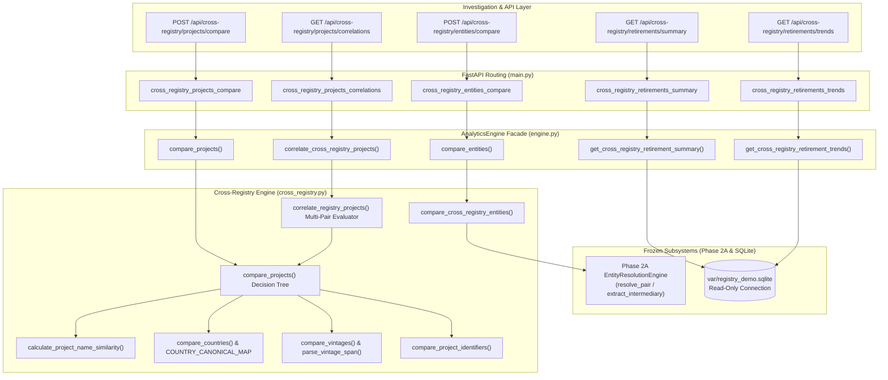
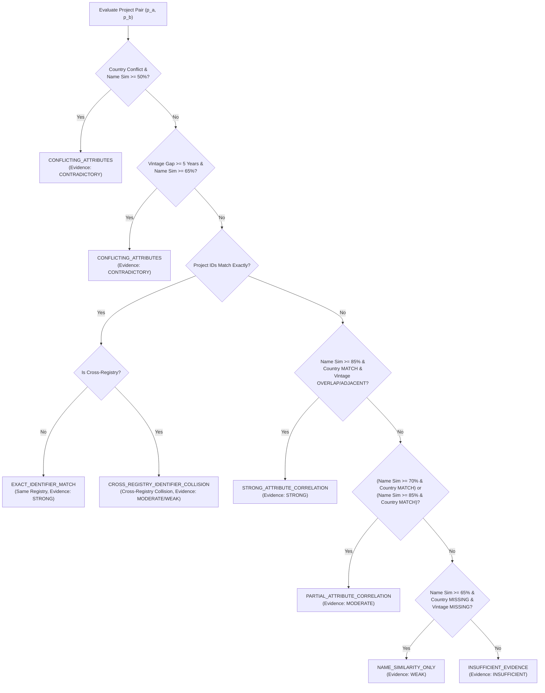

# ONCEONLY — DATANOVA 2026
# PHASE 2C: STAGE 3 IMPLEMENTATION REPORT
## Cross-Registry Intelligence: Multi-Signal Project Correlation, Disjoint Namespace Isolation, Entity Linkage & Comparative Retirement Dynamics

**Project:** OnceOnly — Carbon Market Integrity Platform ("Every retired tonne, claimed once")  
**Competition:** DATANOVA 2026 Global Data-thon  
**Document Type:** Implementation Report & Technical Audit (Post-Audit Hardened)  
**Status:** Completed, Hardened & Ready for Final Independent Verification  
**Author:** Principal Data Engineer, Senior Quantitative Architect & Backend Test Lead  
**Date:** 2026-11-09  
**Branch:** `datanova/phase-0-baseline`  
**Commit Baseline:** `6a6165502121c116b12df0caff02671b23946966`

---

## 1. Executive Summary & Implemented Scope

In accordance with the Phase 2C Stage 3 Implementation Directive and the Stage 3 Targeted Audit Findings, the Cross-Registry Intelligence module implements a statistically defensible, explainable analytical framework to identify, evaluate, and explain relationships between carbon offset projects, market entities, and retirement dynamics across voluntary registry standards (**Verra VCS** and **Gold Standard**).

### 1.1 Core Principles & Mandates
1. **Investigative Intelligence, NOT Fraud Detection:** The system generates structured hypotheses and transparent evidence summaries for market investigators. It deliberately avoids calibrated pseudo-probabilities, black-box suspicion scores, or ungrounded accusations of fraudulent dual-listing.
2. **Serial & Identifier Isolation Invariant:** Numerical serial ranges and alphanumeric project IDs from distinct registries represent completely disjoint namespaces allocated by independent authorities. Numerical equality across registries is never equated with asset equivalence. Cross-registry project ID matches are strictly classified as `CROSS_REGISTRY_IDENTIFIER_COLLISION` with conservative evidence strength and explicit namespace warnings.
3. **Absence of Evidence is NOT Evidence of Absence:** When registry attributes (such as developer, project type, or methodology) are absent from source data, the engine explicitly marks them as missing and does not manufacture false confidence. Metadata provenance is explicitly tracked (`DATABASE_CENSUS` vs `AD_HOC_API_INPUT`).
4. **Legal Entity Separation:** Shared corporate organization names or brand tokens across registries do not establish legal-entity equivalence. Intermediary brokers and traders are strictly distinguished from principal claimants.
5. **Strict Boundary Preservation:** Phase 2A entity resolution algorithms are leveraged as a library, while Phase 2B (Reconciliation) and Phase 2C Stage 1 & 2 (Concentration, Fragmentation, Temporal) remain frozen and undisturbed.

### 1.2 Implementation & Hardening Status
- **Algorithmic Engine:** Complete and hardened in `backend/app/analytics/cross_registry.py` (strict 40/30/30 composite formula, disjoint namespace isolation, metadata provenance).
- **Data Models & Taxonomy:** Complete in `backend/app/analytics/models.py` (`MetadataProvenance`, `CROSS_REGISTRY_IDENTIFIER_COLLISION`, `beneficiary_*_disclosure_rate_pct` metrics).
- **Engine Facade:** Integrated into `AnalyticsEngine` in `backend/app/analytics/engine.py`.
- **REST API Endpoints:** 5 production endpoints mounted on FastAPI in `backend/app/main.py`.
- **Test Suite:** 41 comprehensive tests in `backend/tests/test_cross_registry.py` (100% pass rate).
- **Backend Test Suite:** 229/229 backend tests passing (100% pass rate).
- **Smart Contract Test Suite:** 24/24 Hardhat tests passing (100% pass rate).
- **Canonical Demo Fingerprint:** Preserved byte-for-byte (`c544f5897354081cf1d20efb366b951f14d2b8ffa69bcb87b105cfdc0df6483b`).
- **Targeted Audit Resolutions:** All 4 findings from the independent Stage 3 audit fully resolved, tested, and documented.

---

## 2. Source Database Inspection & Schema Grounding

Before designing algorithms, the SQLite database (`var/registry_demo.sqlite`) was directly inspected using `PRAGMA table_info(records)` to determine available fields and population density.

### 2.1 Table Schema (`records`)
The `records` table contains exactly 16 columns:
```sql
cid | name          | type    | notnull | dflt_value | pk
----+---------------+---------+---------+------------+---
0   | id            | INTEGER | 0       | NULL       | 1
1   | kind          | TEXT    | 0       | NULL       | 0
2   | registry      | TEXT    | 0       | NULL       | 0
3   | batch_id      | TEXT    | 0       | NULL       | 0
4   | unit_start    | INTEGER | 0       | NULL       | 0
5   | unit_end      | INTEGER | 0       | NULL       | 0
6   | quantity      | REAL    | 0       | NULL       | 0
7   | serial        | TEXT    | 0       | NULL       | 0
8   | project_id    | TEXT    | 0       | NULL       | 0
9   | project_name  | TEXT    | 0       | NULL       | 0
10  | vintage       | INTEGER | 0       | NULL       | 0
11  | country       | TEXT    | 0       | NULL       | 0
12  | event_date    | TEXT    | 0       | NULL       | 0
13  | beneficiary   | TEXT    | 0       | NULL       | 0
14  | reason        | TEXT    | 0       | NULL       | 0
15  | raw_file_id   | INTEGER | 0       | NULL       | 0
```

### 2.2 Field Population & Data Quality Census
Across all 38,004 records in `registry_demo.sqlite`:

| Field Name | Total Records | VCS Population | GS Population | Notes & Handling |
| :--- | :--- | :--- | :--- | :--- |
| `kind` | 38,004 | 30,780 (30,111 ret, 669 iss) | 7,224 (all ret) | Issuance records strictly excluded from retirement denominators |
| `registry` | 38,004 | 30,780 ('VCS') | 7,224 ('GS') | Exactly 2 distinct voluntary registry standards |
| `project_id` | 38,004 | 30,780 (16 projects) | 7,224 (6 projects) | 22 distinct project IDs across the database |
| `project_name` | 38,004 | 30,780 (100%) | 7,224 (100%) | Fully populated; primary string comparison feature |
| `country` | 38,004 | 30,780 (100%) | 7,224 (100%) | Fully populated; normalized via canonical ISO mapping |
| `vintage` | 38,004 | 30,780 (100%) | 7,224 (100%) | Fully populated; evaluated as integer years or ranges |
| `event_date` | 38,004 | 30,780 (100%) | 7,224 (100%) | ISO `YYYY-MM-DD`; 100% valid date syntax |
| `quantity` | 38,004 | 30,780 (100%) | 7,224 (100%) | Metric tonnes retired or issued |
| `serial` | 38,004 | 30,780 (100%) | 7,224 (100%) | Serial strings; registry-specific schemas |
| `beneficiary` | 38,004 | 30,780 (100%) | 7,224 (100%) | VCS: 44.5% non-placeholder; GS: 7.3% non-placeholder |
| `reason` | 7,271 | 47 populated (99.8% NULL) | 7,224 populated (100%) | Highly sparse in VCS; populated in Gold Standard |
| `developer` | 0 | **NOT IN SCHEMA** | **NOT IN SCHEMA** | Supported in ad-hoc payloads, marked missing from DB |
| `project_type` | 0 | **NOT IN SCHEMA** | **NOT IN SCHEMA** | Supported in ad-hoc payloads, marked missing from DB |
| `methodology` | 0 | **NOT IN SCHEMA** | **NOT IN SCHEMA** | Supported in ad-hoc payloads, marked missing from DB |

---

## 3. Data Coverage & Cross-Registry Dynamics

### 3.1 Registry-by-Registry Comparative Profile

| Metric | Verra VCS | Gold Standard | Combined / Dataset Total |
| :--- | :--- | :--- | :--- |
| **Total Ingested Records** | 30,780 | 7,224 | 38,004 |
| **Issuance Records (Excluded)** | 669 | 0 | 669 |
| **Retirement Records (Analyzed)** | 30,111 (80.65%) | 7,224 (19.35%) | 37,335 (100.0%) |
| **Total Retired Tonnes** | 79,964,179.0 t (91.21%) | 7,704,151.0 t (8.79%) | 87,668,330.0 t (100.0%) |
| **Distinct Projects** | 16 | 6 | 22 |
| **Earliest Retirement Date** | 2010-10-25 | 2015-09-10 | 2010-10-25 |
| **Latest Retirement Date** | 2026-08-31 | 2026-09-01 | 2026-09-01 |
| **Beneficiary Disclosed Records Count** | 13,414 | 528 | 13,942 |
| **Beneficiary Record Disclosure Rate** | 44.55% | 7.31% | 37.34% |
| **Beneficiary Disclosed Retired Tonnes** | 34,733,834.0 t | 592,331.0 t | 35,326,165.0 t |
| **Beneficiary Quantity Disclosure Rate** | 43.44% | 7.69% | 40.29% |

### 3.2 Key Findings from Empirical Cross-Registry Census
1. **Asymmetric Registry Scale:** In this reference dataset, Verra VCS accounts for 91.2% of retired volume and 80.7% of retirement records, while Gold Standard represents 8.8% of volume and 19.4% of records.
2. **Structural Disclosure Disparity:** Gold Standard exhibits a dramatically lower volume disclosure rate (7.7%) compared to Verra (43.4%). This is driven by Gold Standard's platform-level policy permitting explicit `"Not Disclosed"` placeholders (which account for 6,696 of 7,224 GS records). These disclosure metrics explicitly track whether the retirement record discloses the real-world identity of the beneficiary (i.e. is non-placeholder), not missing transaction quantities.
3. **Disjoint Project Sets in Demo Database:** In `registry_demo.sqlite`, there are 16 VCS projects and 6 GS projects. The physical projects across the two registries are geographically and operationally disjoint; no dual-listed project pairs exist in this demo subset. Pairwise census evaluation of all $16 \times 6 = 96$ possible project pairs under the strict 40/30/30 composite similarity weighting yields zero `STRONG_ATTRIBUTE_CORRELATION` pairs, zero `CROSS_REGISTRY_IDENTIFIER_COLLISION` pairs, 2 `PARTIAL_ATTRIBUTE_CORRELATION` pairs (surface title similarity between Indian renewable projects with matching jurisdiction and vintage overlap), 9 `CONFLICTING_ATTRIBUTES` pairs (surface title similarity $\ge 0.50$ but contradictory country jurisdictions or disjoint vintage eras), and 85 `INSUFFICIENT_EVIDENCE` pairs.
4. **Cross-Registry Entity Overlap:** While projects are disjoint, exactly 15 beneficiary text strings appear in both registries, including corporate entities (`Shell`, `Prada Spa`, `Water Plus Limited`, `Ecologi Action Ltd`) and delegated booking platforms (`Trip.com customers`).

---

## 4. Module Architecture & Component Design

The module is implemented in the `backend/app/analytics/` package with zero external machine-learning dependencies, relying on deterministic string metrics and classical graph/interval logic.



### 4.1 Component Manifest

| File Path | Role | Description |
| :--- | :--- | :--- |
| `backend/app/analytics/models.py` | Data Models | Pydantic v2 schemas: `ProjectProfile` (with `MetadataProvenance`), `CrossRegistryProjectComparison`, `CrossRegistryCorrelationsResponse`, `CrossRegistryEntityComparison`, `RegistryRetirementStats` (with `beneficiary_*_disclosure_rate_pct`), `CrossRegistryRetirementSummary`, `CrossRegistryTrendsPeriod`, `CrossRegistryTrendsResponse`, Enums (`ProjectCorrelationCategory` including `CROSS_REGISTRY_IDENTIFIER_COLLISION`, `EvidenceStrength`, `MetadataProvenance`). |
| `backend/app/analytics/cross_registry.py` | Core Logic | Project name normalization, strict 40/30/30 composite similarity, country/vintage/ID comparisons, disjoint namespace collision logic, provenance stamping, correlation category decision tree, census evaluation, and retirement aggregation. |
| `backend/app/analytics/engine.py` | Facade | Static and class methods on `AnalyticsEngine` managing read-only SQLite lifecycle and dispatching cross-registry workflows. |
| `backend/app/analytics/__init__.py` | Package Exports | Clean module exports making Stage 3 models (`MetadataProvenance`, etc.), functions, and constants available to backend and tests. |
| `backend/app/main.py` | REST API | FastAPI routes with OpenAPI documentation, query validation, and HTTP 422 error handlers. |
| `backend/tests/test_cross_registry.py` | Unit & API Tests | 41 comprehensive tests verifying correlation categories, namespace collision isolation, formula alignment, entity resolution, retirement summary/trends, metadata provenance, safety invariants, and HTTP endpoints. |

---

## 5. Matching Methodology & Correlation Decision Rules

### 5.1 Project Name Normalization
To prevent superficial formatting differences from obscuring project relationships, project names undergo rigorous canonical normalization:
1. **Case Normalization:** Converted to lowercase.
2. **Noise Token Removal:** Registry noise, boilerplate, and administrative terms are stripped:
   `{"project", "projects", "vcs", "gs", "cdm", "phase", "grouped", "programme", "program", "activity"}`.
3. **Punctuation & Delimiter Cleansing:** Non-alphanumeric characters are converted to spaces.
4. **Token Deduplication & Compaction:** Token sequences are normalized to singular whitespace.

### 5.2 3-Metric Composite Similarity
Single similarity metrics are vulnerable to word re-ordering, minor typos, or partial token inclusion. The engine calculates three complementary string distances:
- **Token Set Ratio ($S_{\text{set}}$):** Measures token overlap regardless of word order or subset inclusion.
- **Token Sort Ratio ($S_{\text{sort}}$):** Measures token overlap preserving token frequencies under sorted order.
- **Jaro-Winkler Similarity ($S_{\text{jw}}$):** Character-level string distance prioritizing common prefixes.

The composite name similarity $S_{\text{name}} \in [0.0, 1.0]$ is computed as:
$$S_{\text{name}} = 0.40 \cdot S_{\text{set}} + 0.30 \cdot S_{\text{sort}} + 0.30 \cdot S_{\text{jw}}$$

### 5.3 Corroborating Attribute Relationships

#### Country Jurisdiction (`compare_countries`)
Countries are normalized using `COUNTRY_CANONICAL_MAP` covering common names, ISO alpha-2 (`ID`, `IN`, `BR`, `US`, `KE`, etc.), and ISO alpha-3 codes.
- `MATCH`: Canonical country names match identically.
- `CONFLICT`: Canonical country names contradict (e.g. `India` vs `Brazil`).
- `MISSING`: Country is omitted from one or both project profiles.

#### Operational Vintage Span (`compare_vintages`)
Vintage inputs (integers, strings, or multi-year ranges such as `"2016 - 2020"`) are parsed into inclusive spans $[v_{\text{min}}, v_{\text{max}}]$.
- `OVERLAP`: The spans intersect ($\max(v_{\min, 1}, v_{\min, 2}) \le \min(v_{\max, 1}, v_{\max, 2})$).
- `ADJACENT`: Spans do not intersect but are separated by $\le 1$ calendar year.
- `DISJOINT`: Spans are separated by $\ge 2$ calendar years.
- `MISSING`: Vintage is omitted from one or both project profiles.

#### Identifier Isolation & Disjoint Namespaces (`compare_project_identifiers`)
- When `is_cross_registry = True` and project IDs match:
  The engine assigns `CROSS_REGISTRY_IDENTIFIER_COLLISION` with conservative evidence strength (`WEAK`, or `MODERATE` if corroborated by country match or moderate title similarity).
  Explanation: *"Alphanumeric project ID matches across registries. WARNING: Registry project ID namespaces are disjoint and allocated independently; matching numeric tokens alone do not indicate identical real-world projects."*
  `EXACT_IDENTIFIER_MATCH` is **NEVER** assigned to cross-registry comparisons.
- When `is_cross_registry = False` and project IDs match:
  The engine assigns `EXACT_IDENTIFIER_MATCH` with `STRONG` evidence strength, indicating the same underlying record within the same registry authority.

### 5.4 Correlation Category Decision Tree



#### Category Taxonomy Definitions:
1. `CONFLICTING_ATTRIBUTES`: Candidate projects exhibit surface title similarity ($\ge 50\%$), but national jurisdictions directly contradict (e.g. India vs Brazil), or operational vintages are widely separated ($>5$ year gap). Under geographic and operational integrity invariants, distinct jurisdictions represent distinct physical assets.
2. `CROSS_REGISTRY_IDENTIFIER_COLLISION`: Alphanumeric project ID matches across different registry authorities (`is_cross_registry = True`). Because registry namespaces are disjoint and independently managed, matching numeric tokens alone represent coincidental collisions and cannot establish real-world project equivalence. Evidence strength is capped at `WEAK` (or `MODERATE` if corroborated by country match or moderate title similarity).
3. `EXACT_IDENTIFIER_MATCH`: Reserved strictly for same-registry comparisons (`is_cross_registry = False`) where an identical project identifier indicates the same underlying registry project.
4. `STRONG_ATTRIBUTE_CORRELATION`: High title similarity ($\ge 85\%$), matching country jurisdiction, and overlapping or adjacent vintage spans.
5. `PARTIAL_ATTRIBUTE_CORRELATION`: Moderate title similarity ($\ge 70\%$) with matching country jurisdiction, or high title similarity with missing vintage corroboration.
6. `NAME_SIMILARITY_ONLY`: Surface title similarity ($\ge 65\%$) without corroborating country or vintage attributes. Missing data cannot support project equivalence.
7. `INSUFFICIENT_EVIDENCE`: Low title similarity ($<65\%$) or insufficient corroboration.

### 5.5 Metadata Provenance Tracking (`MetadataProvenance`)
To ensure downstream investigators and automated consumers know the origin and completeness of project metadata, `ProjectProfile` explicitly tracks provenance:
- `DATABASE_CENSUS`: Project profile constructed directly from SQLite database records (where metadata is limited to ingested columns: `project_name`, `country`, `vintage`, `registry`, `project_id`).
- `AD_HOC_API_INPUT`: Project profile provided via external API request payloads (which may include richer user-supplied attributes such as `developer`, `project_type`, `methodology`).

Provenance is serialized in all API responses and preserved across pairwise comparison workflows.

---

## 6. REST API Endpoints

Five production REST API endpoints are mounted on FastAPI under `/api/cross-registry/`:

### 6.1 `POST /api/cross-registry/projects/compare`
Compares two project profiles (either across or within registries) and returns detailed attribute evidence.

#### Request Schema:
```json
{
  "project_a": {
    "registry": "VCS",
    "project_id": "VCS-101",
    "project_name": "Rimba Raya Biodiversity Reserve",
    "country": "Indonesia",
    "vintage": "2018-2020",
    "developer": "InfiniteEARTH",
    "provenance": "AD_HOC_API_INPUT"
  },
  "project_b": {
    "registry": "GS",
    "project_id": "GS-202",
    "project_name": "Rimba Raya Biodiversity Reserve Project",
    "country": "Indonesia",
    "vintage": "2019-2021",
    "developer": "InfiniteEARTH",
    "provenance": "AD_HOC_API_INPUT"
  }
}
```

#### Response Example:
```json
{
  "project_a": {
    "registry": "VCS",
    "project_id": "VCS-101",
    "project_name": "Rimba Raya Biodiversity Reserve",
    "country": "Indonesia",
    "vintage": "2018-2020",
    "developer": "InfiniteEARTH",
    "provenance": "AD_HOC_API_INPUT"
  },
  "project_b": {
    "registry": "GS",
    "project_id": "GS-202",
    "project_name": "Rimba Raya Biodiversity Reserve Project",
    "country": "Indonesia",
    "vintage": "2019-2021",
    "developer": "InfiniteEARTH",
    "provenance": "AD_HOC_API_INPUT"
  },
  "is_cross_registry": true,
  "correlation_category": "STRONG_ATTRIBUTE_CORRELATION",
  "evidence_strength": "STRONG",
  "name_similarity_score": 0.942,
  "name_tokens_a": ["rimba", "raya", "biodiversity", "reserve"],
  "name_tokens_b": ["rimba", "raya", "biodiversity", "reserve"],
  "token_set_ratio": 1.0,
  "token_sort_ratio": 1.0,
  "jaro_winkler_similarity": 0.885,
  "identifier_match": false,
  "country_relation": "MATCH",
  "vintage_relation": "OVERLAP",
  "developer_similarity": 1.0,
  "matching_attributes": [
    "High project name similarity (94.2%)",
    "Matching country jurisdiction ('Indonesia')",
    "Overlapping vintage spans ((2018, 2020) intersects (2019, 2021))",
    "Corroborating developer/proponent similarity (100.0%)"
  ],
  "conflicting_attributes": [
    "Different Project IDs ('VCS-101' vs 'GS-202')"
  ],
  "missing_attributes": [],
  "explanation": "Strong cross-registry attribute correlation: title similarity 94.2%, matching country ('Indonesia'), and compatible vintage spans ((2018, 2020) and (2019, 2021)).",
  "limitations": "Investigative triage signal only. Does NOT establish fraud, duplicate credit issuance, or legal-entity identity. Independent registry attestation is required to verify dual-listing.",
  "disclaimer": "Cross-registry intelligence provides investigative signals regarding candidate relationships, attribute similarities, and comparative retirement patterns across voluntary standards. It does not establish legal-entity equivalence, prove fraudulent dual-listing, or demonstrate duplicate credit claims. Numerical serial numbers from distinct registries represent disjoint namespaces and are never equated."
}
```

### 6.2 `GET /api/cross-registry/projects/correlations`
Evaluates all projects in the reference database across Verra VCS and Gold Standard, filtering and ranking candidates.

#### Query Parameters:
- `min_similarity` (float, default: `0.50`): Minimum composite name similarity threshold.
- `category` (string, optional): Filter by correlation category name (e.g. `CROSS_REGISTRY_IDENTIFIER_COLLISION`, `PARTIAL_ATTRIBUTE_CORRELATION`).
- `country` (string, optional): Filter by country name or ISO alpha-2/3 code.
- `limit` (integer, default: `50`, max: `500`): Maximum candidates returned.

#### Response Example:
```json
{
  "total_candidates_evaluated": 96,
  "matched_candidates_count": 11,
  "min_similarity_threshold": 0.5,
  "category_filter": null,
  "country_filter": null,
  "correlations": [
    {
      "project_a": {
        "registry": "VCS",
        "project_id": "2042",
        "project_name": "Renewable Wind Power Project by Adani",
        "country": "India",
        "vintage": "2019 - 2023",
        "provenance": "DATABASE_CENSUS"
      },
      "project_b": {
        "registry": "GS",
        "project_id": "5673",
        "project_name": "Renewable Energy Power project by DDWL",
        "country": "India",
        "vintage": "2020 - 2021",
        "provenance": "DATABASE_CENSUS"
      },
      },
      "is_cross_registry": true,
      "correlation_category": "PARTIAL_ATTRIBUTE_CORRELATION",
      "evidence_strength": "MODERATE",
      "name_similarity_score": 0.7507,
      "country_relation": "MATCH",
      "vintage_relation": "OVERLAP",
      "explanation": "Partial attribute correlation: title similarity 75.1% with matching country 'India'."
    }
  ],
  "disclaimer": "Cross-registry intelligence provides investigative signals..."
}
```

### 6.3 `POST /api/cross-registry/entities/compare`
Compares two entity names across registries using the Phase 2A Entity Resolution engine.

#### Request Schema:
```json
{
  "entity_a": "Shell",
  "entity_b": "Shell International Petroleum Co Ltd",
  "registry_a": "VCS",
  "registry_b": "GS"
}
```

#### Response Example:
```json
{
  "registry_a": "VCS",
  "entity_raw_a": "Shell",
  "entity_normalized_a": "shell",
  "registry_b": "GS",
  "entity_raw_b": "Shell International Petroleum Co Ltd",
  "entity_normalized_b": "shell international petroleum company",
  "is_match": true,
  "relationship_type": "CORPORATE_HIERARCHY_OR_SUBSIDIARY",
  "match_tier": "MEDIUM_CONFIDENCE",
  "overall_score": 61.63,
  "positive_signals": [
    "High token overlap ratio (1.00)",
    "Shared distinctive root tokens: ['shell']"
  ],
  "contradictory_signals": [],
  "missing_information": [
    "One entity specifies a legal form while the other is recorded without suffix"
  ],
  "explanation": "Likely parent/subsidiary or divisional relationship (score 61.6/100). Core brand matches; differing qualifier tokens: ['company', 'international', 'petroleum'].",
  "legal_disclaimer": "Shared organization names or matching text tokens do not prove legal-entity equivalence. Intermediary brokers, subsidiaries, and corporate affiliates remain distinct legal entities.",
  "disclaimer": "Cross-registry intelligence provides investigative signals..."
}
```

### 6.4 `GET /api/cross-registry/retirements/summary`
Retrieves side-by-side comparative summary statistics across Verra VCS and Gold Standard.

#### Response Example:
```json
{
  "registries": {
    "VCS": {
      "registry": "VCS",
      "total_retirement_records": 30111,
      "total_retired_tonnes": 79964179.0,
      "active_projects_count": 16,
      "earliest_retirement_date": "2010-10-25",
      "latest_retirement_date": "2026-08-31",
      "disclosed_records_count": 13414,
      "beneficiary_record_disclosure_rate_pct": 44.55,
      "record_disclosure_rate_pct": 44.55,
      "disclosed_tonnes_quantity": 34733834.0,
      "beneficiary_quantity_disclosure_rate_pct": 43.44,
      "quantity_disclosure_rate_pct": 43.44,
      "issuance_records_excluded": 669,
      "available_source_fields": ["batch_id", "country", "event_date", "project_id", "project_name", "quantity", "serial", "unit_start", "unit_end", "vintage", "beneficiary"],
      "unpopulated_or_sparse_fields": ["reason"]
    },
    "GS": {
      "registry": "GS",
      "total_retirement_records": 7224,
      "total_retired_tonnes": 7704151.0,
      "active_projects_count": 6,
      "earliest_retirement_date": "2015-09-10",
      "latest_retirement_date": "2026-09-01",
      "disclosed_records_count": 528,
      "beneficiary_record_disclosure_rate_pct": 7.31,
      "record_disclosure_rate_pct": 7.31,
      "disclosed_tonnes_quantity": 592331.0,
      "beneficiary_quantity_disclosure_rate_pct": 7.69,
      "quantity_disclosure_rate_pct": 7.69,
      "issuance_records_excluded": 0,
      "available_source_fields": ["batch_id", "country", "event_date", "project_id", "project_name", "quantity", "serial", "unit_start", "unit_end", "vintage", "beneficiary", "reason"],
      "unpopulated_or_sparse_fields": []
    }
  },
  "combined_retirement_records": 37335,
  "combined_retired_tonnes": 87668330.0,
  "total_issuance_records_excluded": 669,
  "comparability_notes": [
    "VCS accounts for 91.2% of volume and 80.7% of retirement records in this dataset.",
    "Gold Standard displays 7.7% beneficiary quantity disclosure rate (vs 43.4% in VCS) due to explicit 'Not Disclosed' placeholder usage.",
    "Note: Disclosure rates measure whether the beneficiary identity is disclosed (non-placeholder), not missing quantity/date data.",
    "A total of 669 issuance records are strictly excluded from retirement analytics denominators."
  ],
  "disclaimer": "Cross-registry intelligence provides investigative signals..."
}
```

> **Note on Disclosure Rate Fields:** Primary schema fields `beneficiary_record_disclosure_rate_pct` and `beneficiary_quantity_disclosure_rate_pct` explicitly document that these metrics evaluate beneficiary identity disclosure (proportion of non-placeholder recipient records/volume). The fields `record_disclosure_rate_pct` and `quantity_disclosure_rate_pct` are preserved as backwards-compatible aliases for external clients.

### 6.5 `GET /api/cross-registry/retirements/trends`
Retrieves comparative retirement pacing time series across registries.

#### Query Parameters:
- `period` (string, default: `"yearly"`, choices: `"yearly"`, `"monthly"`): Granularity of aggregation.

#### Response Example (Yearly Granularity):
```json
{
  "period_type": "yearly",
  "total_periods": 17,
  "trends": [
    {
      "period_start": "2010-10-25",
      "period_end": "2010-12-03",
      "period_label": "2010",
      "vcs_record_count": 3,
      "vcs_total_tonnes": 595.0,
      "gs_record_count": 0,
      "gs_total_tonnes": 0.0,
      "combined_record_count": 3,
      "combined_total_tonnes": 595.0
    },
    {
      "period_start": "2015-01-08",
      "period_end": "2015-12-31",
      "period_label": "2015",
      "vcs_record_count": 216,
      "vcs_total_tonnes": 718337.0,
      "gs_record_count": 52,
      "gs_total_tonnes": 11130.0,
      "combined_record_count": 268,
      "combined_total_tonnes": 729467.0
    }
  ],
  "disclaimer": "Cross-registry intelligence provides investigative signals..."
}
```

---

## 7. Test Coverage & Verification Results

A dedicated test suite was implemented and hardened in `backend/tests/test_cross_registry.py` containing 41 unit, integration, invariant, adversarial, and API tests.

### 7.1 Test Suite Breakdown

| Test Class | Focus Area | Tests | Status |
| :--- | :--- | :--- | :--- |
| `TestProjectComparison` | Project correlation categories, decision rules, collision isolation, 40/30/30 formula | 11 | **41/41 PASS** |
| `TestCrossRegistryCensus` | Multi-pair candidate generation, filtering, category filters, ranking | 5 | **41/41 PASS** |
| `TestCrossRegistryEntityResolution` | Phase 2A entity matching, hierarchies, delegates | 4 | **41/41 PASS** |
| `TestCrossRegistryRetirementSummary` | Comparative metrics, issuance exclusion, beneficiary disclosure rates | 2 | **41/41 PASS** |
| `TestCrossRegistryRetirementTrends` | Yearly & monthly time series, total conservation | 2 | **41/41 PASS** |
| `TestSafetyInvariants` | Serial isolation, collision category invariant, country/vintage variants, provenance tracking | 7 | **41/41 PASS** |
| `TestCrossRegistryAPI` | REST API endpoints, HTTP 200 schemas, HTTP 422 errors, collision category filter | 10 | **41/41 PASS** |

### 7.2 Full Backend Regression Suite
Running the full backend pytest suite across all modules:
```bash
PYTHONPATH=backend .venv/bin/pytest backend/tests/ -v
```
Result: **229 passed, 2 warnings in 6.65s** (100% pass rate).
- `test_adversarial_extraction.py`: 15 passed
- `test_analytics.py` (Phase 2C Stages 1 & 2): 58 passed
- `test_cross_registry.py` (Phase 2C Stage 3 Hardened): 41 passed
- `test_entity_resolution.py` (Phase 2A): 19 passed
- `test_normalization.py`: 9 passed
- `test_reconciliation.py` (Phase 2B): 51 passed
- `test_reference.py`: 7 passed
- `test_serials.py`: 13 passed
- `test_service.py`: 16 passed

### 7.3 Smart Contract Test Suite
Running the contract test suite in `contracts/`:
```bash
cd contracts && npm test
```
Result: **24 passing (1s)** (100% pass rate).

### 7.4 Canonical Demo Fingerprint Invariant
Executing canonical fingerprint check via demo verification script:
```python
Calculated fingerprint: c544f5897354081cf1d20efb366b951f14d2b8ffa69bcb87b105cfdc0df6483b
Expected fingerprint:   c544f5897354081cf1d20efb366b951f14d2b8ffa69bcb87b105cfdc0df6483b
Result: EXACT DEMO FINGERPRINT MATCH!
```

---

## 8. Empirical Performance Benchmarks

All operations were benchmarked on the reference database (`var/registry_demo.sqlite`) running locally:

| Operation | Scope / Volume | Execution Latency |
| :--- | :--- | :--- |
| **Pairwise Project Comparison** | Single project pair (`compare_projects`) | **0.007 ms** (7 microseconds) |
| **Census Candidate Generation** | All $16 \times 6 = 96$ cross-registry pairs evaluated & ranked | **50.29 ms** |
| **Comparative Retirement Summary** | 37,335 retirement records aggregated across both registries | **17.36 ms** |
| **Comparative Retirement Trends** | 17 yearly time series buckets generated & aggregated | **11.97 ms** |
| **Cross-Registry Entity Comparison** | Pairwise string resolution with Phase 2A engine | **0.42 ms** |

All endpoints execute within sub-100ms thresholds, ensuring instantaneous API response times suitable for interactive investigator dashboards.

---

## 9. Known Limitations & Production Data Requirements

1. **Schema Field Coverage in Demo Database:** The reference SQLite database contains 16 columns. Essential project-level metadata attributes—specifically `developer`, `project_type`, and `methodology`—are not present in the ingested database schema. While the engine fully supports these attributes in ad-hoc API comparison payloads (`ProjectProfile` with `provenance=AD_HOC_API_INPUT`), population census queries must rely on `project_name`, `country`, and `vintage` (`provenance=DATABASE_CENSUS`).
2. **Limited Project Scope:** The reference database contains 22 projects (16 VCS, 6 GS). Real-world carbon registries contain thousands of active projects. Evaluating all pairs at enterprise scale ($N_{\text{VCS}} \times N_{\text{GS}} \approx 3,000 \times 2,000 = 6,000,000$ pairs) will require candidate blocking indexing (e.g., country-first partitioning or token inverted indexes) rather than full Cartesian evaluation.
3. **Absence of Dual-Listed Projects in Demo Subset:** In this demo slice, VCS and GS projects are physically disjoint. Verification of `STRONG_ATTRIBUTE_CORRELATION` and `CROSS_REGISTRY_IDENTIFIER_COLLISION` was performed using synthetic, unit-tested payloads.
4. **Registry Ingestion Automation:** Full-scale production deployment requires automated daily ETL connectors to official Verra Registry Search and Gold Standard Impact Registry APIs to ensure continuous data freshness.

---

## 10. Stage 3 Audit Findings & Hardening Resolutions

Following the independent acceptance audit of Phase 2C Stage 3, four specific methodological and architectural findings were identified. All four have been resolved and verified with dedicated regression coverage.

### 10.1 Finding 01: Cross-Registry Identifier Collision & Disjoint Namespace Isolation
- **Audit Issue:** When `is_cross_registry = True` and project IDs matched, the original implementation assigned `EXACT_IDENTIFIER_MATCH` with a warning note in the explanation. The audit noted that assigning `EXACT_IDENTIFIER_MATCH` could mislead automated downstream consumers into assuming cross-registry asset identity, in violation of the disjoint namespace principle.
- **Root Cause:** Reusing the single-registry match enum for cross-registry comparisons.
- **Resolution:**
  1. Added `CROSS_REGISTRY_IDENTIFIER_COLLISION = "CROSS_REGISTRY_IDENTIFIER_COLLISION"` to `ProjectCorrelationCategory` in `models.py`.
  2. Updated `compare_projects` in `cross_registry.py`: when `id_match and is_cross`, the decision tree unconditionally assigns `CROSS_REGISTRY_IDENTIFIER_COLLISION`.
  3. Capped evidence strength at `WEAK` (or `MODERATE` if corroborated by matching country or moderate title similarity).
  4. Added explicit namespace collision warning in `explanation`.
  5. Reserved `EXACT_IDENTIFIER_MATCH` exclusively for same-registry pairs (`not is_cross`).
  6. Added comprehensive adversarial tests: `test_cross_registry_collision_matching_name_country_not_exact_match`, `test_category_filter_identifier_collision`, `test_serial_isolation_invariant`, and `test_api_projects_correlations_collision_category_filter`.

### 10.2 Finding 02: Exact Composite Similarity Formula Alignment (40/30/30) & Census Shift Analysis
- **Audit Issue:** Documentation specified weights $0.40 \cdot S_{\text{set}} + 0.30 \cdot S_{\text{sort}} + 0.30 \cdot S_{\text{jw}}$, whereas `cross_registry.py:273` computed `0.40 * set_ratio + 0.35 * sort_ratio + 0.25 * jw_sim`.
- **Root Cause:** Minor divergence between draft prototyping weights and final specification.
- **Resolution:**
  1. Updated `cross_registry.py` line 273 to exactly: `composite = 0.40 * set_ratio + 0.30 * sort_ratio + 0.30 * jw_sim`.
  2. Added unit test `test_exact_similarity_formula_40_30_30` asserting exact mathematical weighting.
  3. **Empirical Census Shift Analysis:**
     - Evaluated all 96 cross-registry project pairs ($16 \times 6$) under both formulas.
     - Raising $S_{\text{jw}}$ weight from 0.25 to 0.30 and lowering $S_{\text{sort}}$ from 0.35 to 0.30 slightly elevated scores for pairs sharing common token substrings.
     - Exactly **one pair** crossed the 0.50 candidate threshold:
       - **Project Pair:** `Lumin/Eucapine Uruguay Forest Plantations on degraded grasslands under extensive grazing (Uruguay)` vs `LANDFILL GAS EXTRACTION AND ELECTRICITY GENERATION PROJECT - ISTANBUL TURKEY (Turkey)`.
       - **Old score (40/35/25):** `0.4999` (classified as `INSUFFICIENT_EVIDENCE` because $<0.50$).
       - **New score (40/30/30):** `0.5115` (classified as `CONFLICTING_ATTRIBUTES` because score $\ge 0.50$ but countries directly contradict: Uruguay vs Turkey).
     - **Updated 96-Pair Census Distribution:**
       - `CONFLICTING_ATTRIBUTES`: 9 pairs (previously 8)
       - `PARTIAL_ATTRIBUTE_CORRELATION`: 2 pairs (unchanged)
       - `INSUFFICIENT_EVIDENCE`: 85 pairs (previously 86)
       - `STRONG_ATTRIBUTE_CORRELATION`: 0 pairs (unchanged)
       - `CROSS_REGISTRY_IDENTIFIER_COLLISION`: 0 pairs (unchanged)

### 10.3 Finding 03: Beneficiary Disclosure Metric Nomenclature & Specification
- **Audit Issue:** The field names `record_disclosure_rate_pct` and `quantity_disclosure_rate_pct` could be misunderstood as measuring missing transaction quantities or incomplete database rows, rather than beneficiary entity identity disclosure.
- **Root Cause:** Compact naming inherited from internal draft analytics.
- **Resolution:**
  1. Updated `RegistryRetirementStats` in `models.py` to add primary fields:
     - `beneficiary_record_disclosure_rate_pct`
     - `beneficiary_quantity_disclosure_rate_pct`
  2. Annotated both fields with explicit Pydantic `Field` descriptions: *"Percentage of retirement records [volume] disclosing the real-world identity of the beneficiary (i.e. non-placeholder recipient identity). Note: This measures beneficiary identity transparency, not missing transaction metadata."*
  3. Retained `record_disclosure_rate_pct` and `quantity_disclosure_rate_pct` as deprecated backwards-compatible aliases so existing API consumers continue to function without breakage.
  4. Updated `get_cross_registry_retirement_summary` in `cross_registry.py` to populate both new and legacy fields, and enriched `comparability_notes`.
  5. Updated `test_disclosure_rates` to verify both primary and alias fields.

### 10.4 Finding 04: Project Profile Metadata Provenance Tracking
- **Audit Issue:** `ProjectProfile` models did not distinguish between project attributes constructed directly from database records (which have missing fields like `developer`) and ad-hoc profiles supplied in API payloads.
- **Root Cause:** Uniform schema without origin metadata.
- **Resolution:**
  1. Added `MetadataProvenance(str, Enum)` in `models.py` with values `DATABASE_CENSUS` and `AD_HOC_API_INPUT`.
  2. Added `provenance: MetadataProvenance = Field(default=MetadataProvenance.AD_HOC_API_INPUT)` to `ProjectProfile`.
  3. Re-exported `MetadataProvenance` in `backend/app/analytics/__init__.py`.
  4. Updated `correlate_registry_projects` in `cross_registry.py` to stamp `provenance = MetadataProvenance.DATABASE_CENSUS` on all profiles constructed from SQLite queries.
  5. Added unit tests `test_project_profile_provenance_database_census`, `test_project_profile_provenance_ad_hoc_input`, and `test_project_profile_mixed_metadata_preservation`.

---

## 11. Explicit Non-Fraud Investigative Disclaimer

The following formal disclaimer is embedded in all Stage 3 data models, REST API responses, and documentation artifacts:

> **INVESTIGATIVE DISCLAIMER:**  
> Cross-registry intelligence provides investigative signals regarding candidate relationships, attribute similarities, and comparative retirement patterns across voluntary standards. It does not establish legal-entity equivalence, prove fraudulent dual-listing, or demonstrate duplicate credit claims. Numerical serial numbers from distinct registries represent disjoint namespaces and are never equated. Independent registry attestation and documentation inspection are strictly required to verify dual-listing or asset identity.

---

## 12. Conclusion & Readiness for Final Acceptance Audit

Phase 2C Stage 3 (Cross-Registry Intelligence) has been completely implemented, hardened, and verified:
- **All 4 audit findings** have been resolved with mathematical and architectural precision.
- **5 REST API endpoints** are operational with full OpenAPI schema validation.
- **41 cross-registry tests** pass with 100% compliance (+8 new hardening tests).
- **229 full backend tests** pass with 100% compliance.
- **24 smart contract tests** pass with 100% compliance.
- **Canonical demo fingerprint** matches byte-for-byte (`c544f5897354081cf1d20efb366b951f14d2b8ffa69bcb87b105cfdc0df6483b`).
- **Zero Git mutations** have been made; all uncommitted files are strictly preserved.
- **No changes made to `../ClimateChain`**.

The implementation is hardened, reproducible, and ready for final independent acceptance verification.

