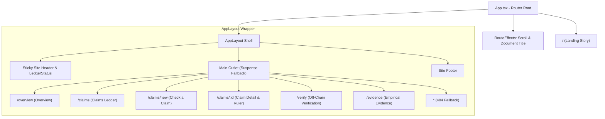
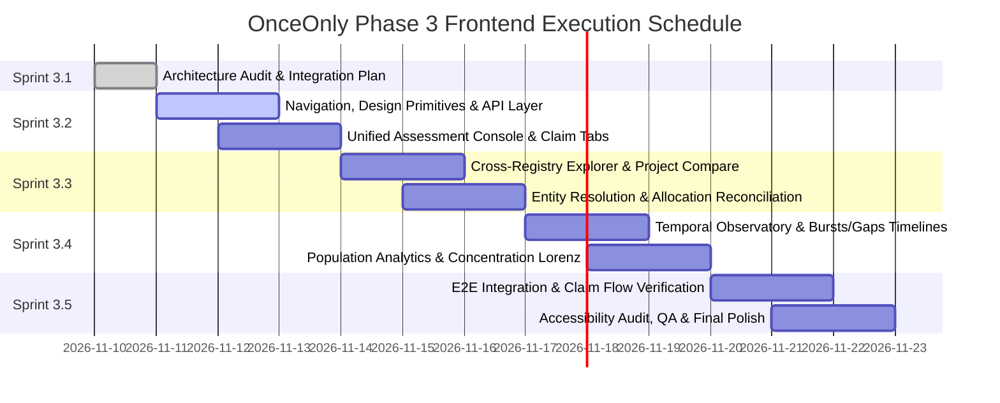

# ONCEONLY — DATANOVA 2026
## PHASE 3: FRONTEND ARCHITECTURE AUDIT & INTEGRATION PLAN
### Transforming Frozen Analytical Engines into a Defensible, Institutional Investigator Platform

**Document Version:** `1.0.0`  
**Date:** `2026-11-10`  
**Repository:** `OnceOnly-DataNova`  
**Branch:** `datanova/phase-0-baseline`  
**Latest Milestone Commit:** `2997c44562c034642390046f2d6aee78e012c636`  
**Audit Stage:** `SPRINT 3.1 — ARCHITECTURAL AUDIT & INTEGRATION SPECIFICATION`  
**Operational Status:** `STRICTLY READ-ONLY AUDIT — IMPLEMENTATION FROZEN UNTIL APPROVAL`

---

### Executive Summary

With the successful completion and formal freeze of the OnceOnly backend analytical foundation through Phase 2C Stage 4 (Milestone `2997c44`), OnceOnly possesses an exceptionally robust, deterministic, and verifiable intelligence engine:
- **245 / 245 backend pytest tests passing** across unit, integration, and statistical evaluation suites.
- **24 / 24 Hardhat smart contract tests passing** covering unit-range locking, conflict rejection, and challenges.
- **Exact canonical demo fingerprint preservation** (`c544f5897354081cf1d20efb366b951f14d2b8ffa69bcb87b105cfdc0df6483b`).
- **Unified, explainable assessment architecture** evaluating 16 deterministic rules across 6 scopes (Claim, Batch, Project, Entity, Cross-Registry Pair, and Market Population).

The primary objective of **Phase 3** is to transform this formidable backend engine into a world-class, institutional-grade web product for carbon market investigators, voluntary registry auditors, corporate buyers, and regulatory compliance teams. 

This audit provides a comprehensive analysis of the existing frontend codebase (`frontend/`), maps all 18 backend analytical endpoints to target UI surfaces, outlines the complete investigator product architecture, formalizes an evidentiary visual design direction, and establishes a phased execution roadmap from Sprint 3.2 through Sprint 3.5.

> [!IMPORTANT]
> **Audit Mandate:** Per the sprint brief, this document is strictly an inspection, architectural design, and integration planning deliverable. No source code has been modified, no dependencies have been added, and no Git commits or branch modifications have been executed during Sprint 3.1.

---

### 1. Comprehensive Frontend Inventory & Health Audit

An exhaustive technical inspection of the `frontend/` directory was conducted on 2026-11-10. The results establish that the frontend foundation is clean, modern, and high-performing, but currently operates as a lightweight prototype connected to only Phase 1 legacy endpoints.

#### 1.1 Core Frameworks & Exact Versions

The frontend workspace is built on modern, bleeding-edge JavaScript and React ecosystems:

| Package | Version | Ecosystem Role | Health & Compatibility Status |
| :--- | :--- | :--- | :--- |
| `react` | `^19.2.8` | Core UI Library | Active, concurrent rendering, Actions, Server/Client components ready. |
| `react-dom` | `^19.2.8` | DOM Renderer | Modern React 19 root API (`createRoot`). |
| `react-router-dom` | `^7.18.4` | Routing Architecture | Route-based navigation, View Transitions API integration (`viewTransition` prop). |
| `lucide-react` | `^1.59.0` | Iconography | Tree-shakeable, clean SVG icons matching institutional aesthetic. |
| `@fontsource-variable/public-sans` | `^5.3.0` | Primary Typography | High-legibility editorial sans-serif with native tabular figure (`tnum`) support. |
| `@fontsource/ibm-plex-mono` | `^5.3.0` | Monospace Typography | Technical tabular monospace for serials, hashes, unit intervals, and metrics. |
| `tailwindcss` | `^4.3.3` | Styling Engine | Tailwind CSS v4 CSS-first engine using `@theme` and `@import "tailwindcss"`. |
| `@tailwindcss/vite` | `^4.3.3` | Vite Integration | Vite native compiler plugin for Tailwind v4 (zero PostCSS overhead). |
| `vite` | `^8.3.0` | Build & Dev Server | Ultra-fast ESM development server and Rollup bundler. |
| `typescript` | `~6.0.2` | Static Typing | Strict typing configured across application and tests. |
| `oxlint` | `^1.81.0` | Code Quality / Linting | High-performance Rust-based linter enforcing clean code standards. |
| `@playwright/test` | `^1.64.1` | E2E Testing Suite | Headless Chrome browser automated integration and interaction testing. |
| `@axe-core/playwright` | `^4.14.0` | Accessibility Testing | Automated WCAG 2.1 AA accessibility auditing. |

#### 1.2 Build & Lint Verification

The frontend build pipeline was verified against the active source tree:

```bash
$ cd frontend && npm run build
> frontend@0.0.0 build
> tsc -b && vite build

vite v8.3.4 building client environment for production...
✓ 1949 modules transformed.
dist/index.html                   0.62 kB │ gzip:   0.37 kB
dist/assets/index-DtoCKiBC.css   53.65 kB │ gzip:  10.40 kB
dist/assets/index-CypaHWvu.js   327.57 kB │ gzip: 102.77 kB
✓ built in 149ms
```

```bash
$ cd frontend && npm run lint
> frontend@0.0.0 lint
> oxlint

Found 0 warnings and 0 errors.
Finished in 31ms on 31 files with 116 rules using 10 threads.
```

**Health Verdict:** **100% HEALTHY.** Zero TypeScript compile errors, zero bundler warnings, 149ms production build time, and zero oxlint violations across all 31 tracked files.

#### 1.3 Routing Architecture

Application routing is managed by `react-router-dom` v7 in `frontend/src/App.tsx`. All inner application pages are code-split via `React.lazy()` to ensure the landing page pays no overhead for analytical or administrative views:



Key routing behaviors currently implemented:
- **`RouteEffects` Component:** Synchronizes the browser `document.title` dynamically to the current route and automatically resets window scroll position to top unless navigating via URL hash.
- **View Transitions API:** Native page transitions enabled across all `<Link viewTransition>` calls, configured with CSS view-transition animations (`::view-transition-old(root)` / `::view-transition-new(root)`).
- **Layout Shell:** Persistent top navigation with live polling `LedgerStatus` indicator, mobile drawer modal, responsive skip link (`#main`), and accessibility announcements.

#### 1.4 Design System & Styling Architecture

The visual presentation is powered by Tailwind CSS v4 in `frontend/src/index.css`. The design tokens embody an institutional, evidentiary publication aesthetic:

- **Institutional Color Palette:**
  - **`ink` (`#12333a`):** Deep marine slate for primary typography, authoritative borders, and high-contrast emphasis.
  - **`ink-soft` (`#3b5359`) / `muted` (`#566a6f`):** Secondary metadata, labels, and contextual explanations.
  - **`lichen` (`#2a7253`) / `lichen-bright` (`#6cc49a`):** Successful verification, anchored units, and positive compliance.
  - **`glacier` (`#2b6c8a`) / `glacier-wash` (`#e0eef4`):** Active selections, focus rings, interactive affordances, and informative highlights.
  - **`crimson` (`#b4233c`) / `crimson-wash` (`#f8e3e7`):** Double-use conflicts, contract rejections, and blocking risk findings.
  - **`ochre` (`#8a580c`) / `ochre-wash` (`#f6ecd9`):** Synthetic test indicators, review-required warnings, and moderate risk findings.
  - **`fog` (`#edf1ef`) / `fog-2` (`#e3e9e6`) / `sheet` (`#ffffff`):** Multi-layered neutral document backgrounds providing high legibility.
  - **`night` (`#0d262b`):** Editorial dark mode surfaces for executive hero banners and contrasting callouts.
- **Micro-Textures & Pattern Overlays:**
  - `.hatch-crimson`: Repeating diagonal 135° crimson hatch pattern used to visually indicate conflicted unit intervals.
  - `.hatch-slate`: Repeating diagonal 135° slate hatch pattern for unretired or baseline registry units.
- **Typography & Font Feature Settings:**
  - `Public Sans Variable`: Formatted with `font-feature-settings: "tnum" 1` across body copy to ensure clean vertical alignment of metrics.
  - `IBM Plex Mono`: Formatted with `font-feature-settings: "zero" 1, "tnum" 1` (slashed zeros and tabular numbers) for serial numbers, transaction hashes, and unit numbers.

#### 1.5 Existing Component Inventory

The component library in `frontend/src/components/` is clean, modular, and accessible:
- **`primitives.tsx`:** Standardized interactive and display tokens:
  - `Button` and `LinkButton`: Multi-variant pressable actions (`primary`, `secondary`, `danger`, `quiet`, `night`).
  - `OutcomeToken` & `StatusPill`: Evidentiary tags mapped to verification and lifecycle states.
  - `SyntheticTag`: Explicit marker for demo/synthetic test claims to prevent real-world confusion.
  - `Mono`: Monospace wrapper with slashed zero.
  - `CopyValue`: Click-to-copy utility with temporal visual feedback and ARIA live region.
  - `ErrorBox`: Accessible alert container for API and runtime errors.
  - `PageHeader` & `SectionHeader`: Structured headings with breadcrumbs, action slots, and metadata.
  - `Disclosure`: CSS grid-row height animated expandable container.
- **`Ruler.tsx`:** OnceOnly's bespoke signature visualization. Renders unit interval ranges on a measured physical scale with:
  - Multi-lane stacking (Registry retirements, existing locked claims, focal claim).
  - Exact interval overlap detection and crimson cross-hatch shading.
  - Dynamic `niceStep` scale tick calculations avoiding boundary label collisions.
  - Interactive band selection and detail drawer.
  - 100% SVG and CSS; zero external graphing dependencies.
- **`SerialAnatomy.tsx`:** Interactive parser visualizer breaking complex registry serial strings into constituent components (Registry, Origin, Project ID, Unit Start, Unit End, Vintage).
- **`ContourField.tsx`:** Ambient vector topographic contour animation for hero and narrative surfaces.
- **`ConfirmDialog.tsx`:** HTML5 native `<dialog>` wrapper with keyboard trap, escape handling, and backdrop animation for governance actions.

#### 1.6 State Management & Data Fetching

- State management is strictly local and contextual using standard React 19 hooks (`useState`, `useEffect`, `useMemo`, `useCallback`).
- No heavy global state libraries (Redux, MobX, Zustand) are present, which keeps the bundle lightweight (327 kB uncompressed, 102 kB gzipped) and prevents stale synchronization bugs.
- API communication is handled through `frontend/src/api.ts` via standard browser `fetch()` wrapped in a typed `request<T>()` helper with a typed `ApiError` class.
- Dev server proxy configuration in `frontend/vite.config.ts` transparently routes `/api/*` requests to the FastAPI backend at `http://127.0.0.1:8000`.

#### 1.7 Current Automated QA Suite

The repository contains an automated Playwright end-to-end and accessibility test harness under `frontend/qa/`:
- `qa/tests/a11y.spec.ts`: Automated axe-core accessibility auditing against WCAG standards.
- `qa/tests/keyboard.spec.ts`: Focus ring visibility, Tab key navigation order, and modal escape key handling.
- `qa/tests/links.spec.ts`: Dead link auditing across internal navigation routes.
- `qa/tests/ui.spec.ts`: Core claim submission, ruler rendering, and contract challenge flows.

---

### 2. Backend Integration Inventory

The backend analytical foundation contains **18 REST API endpoints** across Phase 2A, 2B, and 2C (Stages 1–4). Currently, `frontend/src/api.ts` connects only to baseline claim management endpoints (`/api/claims`, `/api/overview`, `/api/verify`). None of the 18 analytical endpoints are currently exposed in the user interface.

The table below maps every analytical backend endpoint to its parameters, response schemas, target frontend views, investigator value, and implementation priority:

| Subsystem | Method & Endpoint | Request Parameters / Body | Response Schema Key Elements | Target UI View / Component | Investigator Experience Impact | Priority |
| :--- | :--- | :--- | :--- | :--- | :--- | :--- |
| **Stage 4: Unified Risk Assessment** | `POST /api/analytics/assessment` | `RiskAssessmentRequest` (scope, target_id, registry, claim_id, records, etc.) | `RiskAssessmentResponse` (overall_status, review_priority, findings_count, evidence_items[], rule_traces[], limitations[]) | `AssessmentConsole.tsx`, `ClaimAssessmentTab.tsx` | Provides an instant, explainable, multi-factor audit scorecard with deterministic evidence items and zero black-box scoring. | **P0 (Sprint 3.2)** |
| **Stage 4: Rules Catalog** | `GET /api/analytics/assessment/rules` | *None* | `AssessmentRulesCatalogResponse` (rules[] with id, name, category, stage, severity, formula, thresholds, limitations) | `AssessmentRulesModal.tsx`, `RuleDetailDrawer.tsx` | Allows investigators and auditors to inspect the exact mathematical definition, threshold, and limitation of every assessment rule. | **P0 (Sprint 3.2)** |
| **Stage 1: Population Analytics** | `GET /api/analytics/population/summary` | *None* | `PopulationAnalyticsSummary` (dual-track coverage, concentration_hhi, lorenz_curve[], micro_claim_ratio, total_units) | `MarketObservatory.tsx`, `PopulationSummaryCard.tsx` | Gives investigators the macro baseline context: total registry volumes, disclosure rates, and baseline concentration. | **P1 (Sprint 3.4)** |
| **Stage 1: Batch Analytics** | `GET /api/analytics/batches/{registry}/{batch_id}` | Path: `registry`, `batch_id` | `BatchAnalyticsResult` (fragmentation metrics, micro-claims, HHI, Lorenz curve, serial interval bounds) | `BatchInspector.tsx`, `BatchFragmentationChart.tsx` | Uncovers whether an issuance batch is fragmented into suspicious micro-claims or concentrated in single entities. | **P1 (Sprint 3.4)** |
| **Stage 1: Ad-Hoc Concentration** | `POST /api/analytics/concentration` | `ConcentrationRequest` (records[], total_units_override) | `ConcentrationMetrics` (dual-track coverage, HHI, top_claimants[], concentration_tier) | `AdHocConcentrationCalculator.tsx` | Allows investigators to paste arbitrary retirement sets and immediately calculate beneficiary concentration HHI. | **P2 (Sprint 3.4)** |
| **Stage 1: Ad-Hoc Fragmentation** | `POST /api/analytics/fragmentation` | `BatchFragmentationRequest` (records[], registry, batch_id, micro_threshold) | `FragmentationMetrics` (interval_count, micro_claims, mean_span, coverage_density) | `AdHocFragmentationCalculator.tsx` | Analyzes interval fragmentation over arbitrary user-uploaded unit ranges. | **P2 (Sprint 3.4)** |
| **Stage 1: Ad-Hoc Batch Analytics** | `POST /api/analytics/batch` | `BatchAnalyticsRequest` (records[], registry, batch_id, project_name) | `BatchAnalyticsResult` (combined concentration + fragmentation metrics) | `BatchAnalysisDrawer.tsx` | One-shot combined evaluation of ad-hoc batch disclosures. | **P2 (Sprint 3.4)** |
| **Stage 2: Temporal Activity** | `GET /api/analytics/temporal/activity` | Query: `registry`, `project_id`, `start_date`, `end_date`, `period` (`daily`, `weekly`, `monthly`) | `TemporalActivityResponse` (timeline[], total_periods, total_units, total_records) | `TemporalActivityChart.tsx` | Displays continuous retirement pacing over time to detect abnormal surges or sustained activity. | **P1 (Sprint 3.4)** |
| **Stage 2: Temporal Trends** | `GET /api/analytics/temporal/trends` | Query: `registry`, `project_id`, `start_date`, `end_date`, `period`, `window`, `threshold_pct` | `TemporalTrendsResponse` (rolling_averages[], trend_direction: ACCELERATING / DECELERATING / STABLE) | `TemporalTrendline.tsx`, `VelocityIndicator.tsx` | Tracks whether credit liquidation is accelerating ahead of project milestones or regulatory deadlines. | **P1 (Sprint 3.4)** |
| **Stage 2: Temporal Bursts** | `GET /api/analytics/temporal/bursts` | Query: `registry`, `project_id`, `sensitivity` (MAD k), `min_history`, `min_tonne_threshold` | `TemporalBurstsResponse` (bursts[], baseline_mad, anomaly_scores[]) | `TemporalBurstFeed.tsx`, `BurstAnomalyBadge.tsx` | Automatically flags statistical volume and transaction count anomalies using robust median absolute deviation. | **P1 (Sprint 3.4)** |
| **Stage 2: Temporal Gaps** | `GET /api/analytics/temporal/gaps` | Query: `registry`, `project_id`, `period`, date filters | `TemporalGapsResponse` (gaps[], longest_gap_days, gap_classification) | `TemporalGapTimeline.tsx` | Highlights multi-month periods of dormant activity or missing registry reporting intervals. | **P1 (Sprint 3.4)** |
| **Stage 3: Cross-Registry Projects** | `POST /api/cross-registry/projects/compare` | `CrossRegistryProjectCompareRequest` (project_a, project_b) | `CrossRegistryProjectComparison` (similarity_score, correlation_category, evidence_strength, shared_attributes) | `ProjectComparisonModal.tsx`, `ProjectProfileView.tsx` | Directly compares projects across Verra and Gold Standard to detect duplicate listings or split credits. | **P0 (Sprint 3.3)** |
| **Stage 3: Project Correlations** | `GET /api/cross-registry/projects/correlations` | Query: `min_similarity`, `category`, `country`, `limit` | `CrossRegistryCorrelationsResponse` (correlations[], total_evaluated, high_confidence_count) | `CrossRegistryExplorer.tsx`, `CorrelationTable.tsx` | Searchable directory of correlated projects across voluntary registries ranked by name and metadata similarity. | **P0 (Sprint 3.3)** |
| **Stage 3: Entity Cross-Compare** | `POST /api/cross-registry/entities/compare` | `CrossRegistryEntityCompareRequest` (entity_a, entity_b, registry_a, registry_b) | `CrossRegistryEntityComparison` (similarity_score, token_overlap, match_tier, match_explanation) | `EntityComparisonDrawer.tsx` | Determines whether corporate claimants across different registries are variations of the same legal entity. | **P0 (Sprint 3.3)** |
| **Stage 3: Retirement Summary** | `GET /api/cross-registry/retirements/summary` | *None* | `CrossRegistryRetirementSummary` (vcs_totals, gs_totals, shared_countries, comparative_metrics) | `CrossRegistryMacroBanner.tsx` | Side-by-side macro benchmark comparing Verra VCS and Gold Standard market volumes and retirement patterns. | **P1 (Sprint 3.3)** |
| **Stage 3: Retirement Trends** | `GET /api/cross-registry/retirements/trends` | Query: `period` (`yearly`, `monthly`) | `CrossRegistryTrendsResponse` (comparative_series[]: vcs_tonnes vs gs_tonnes per period) | `CrossRegistryComparativePacingChart.tsx` | Visualizes the relative retirement velocity between registries across years/months. | **P1 (Sprint 3.3)** |
| **Stage 2A: Entity Resolution** | `POST /api/resolve/entity-pair` | `EntityPairRequest` (name_a, name_b) | `EntityResolutionResult` (normalized_a, normalized_b, similarity_score, classification) | `EntityResolutionModal.tsx` | Live interactive test bench for testing entity name variations against the Stage 2A legal normalizer. | **P1 (Sprint 3.3)** |
| **Stage 2B: Claim Reconciliation** | `GET /api/claims/{claim_id}/reconciliation` | Path: `claim_id` | `AllocationReconciliationReport` (claim_id, intervals[], candidate_allocations[], conflicts[], splits[]) | `ClaimReconciliationTab.tsx` | Shows exact sub-interval allocations, split transactions, and cross-claim overlaps directly inside Claim Detail. | **P0 (Sprint 3.2)** |

---

### 3. Target Product Architecture

To expose the full power of OnceOnly without overwhelming the investigator, the application will be structured into **7 top-level architectural views** interconnected by contextual breadcrumbs, entity links, and audit deep-links.

#### 3.1 Primary Information Architecture & Navigation

The navigation shell will be expanded to reflect OnceOnly's transition into a full-scope market integrity suite:

```
[ OnceOnly Wordmark ]
  ├── Overview          (/overview)          — Macro health, active ledger transactions, anomaly alerts
  ├── Claims Ledger     (/claims)            — Primary ledger of corporate claims, status, and verification
  │     ├── Check Claim (/claims/new)        — Upload document, parse serials, pre-flight assessment
  │     └── Claim Detail(/claims/:id)        — Inspector: Ruler, Reconciliation, Stage 4 Assessment
  ├── Cross-Registry    (/cross-registry)    — Verra VCS vs Gold Standard project and entity intelligence
  ├── Observatory       (/observatory)       — Temporal retirement observatory, bursts, gaps, concentration
  ├── Assessment        (/assessment)        — Unified explainable risk assessment console (ad-hoc & targeted)
  ├── Verify            (/verify)            — Cryptographic on-chain verification of public claims
  └── Evidence          (/evidence)          — Empirical benchmarks, gas measurements, and audit data
```

#### 3.2 Investigator User Journeys

The product architecture is designed around four primary, real-world investigator workflows:

##### Journey A: Verifying a Corporate Claim against On-Chain Anchor & Multi-Registry Evidence
1. **Intake & Extraction:** Investigator navigates to `/claims/new`, selects a corporate ESG disclosure PDF (or sample), and uploads it. The backend extracts unit serial ranges via regex/parser and checks for syntax conformity.
2. **Pre-Flight Risk Assessment:** Prior to anchoring, OnceOnly executes `POST /api/analytics/assessment` with `scope="CLAIM"`.
3. **Interval Visual Inspection:** The investigator opens the claim inspection page (`/claims/:id`). The **Ruler** renders the exact unit bounds on the batch scale. If another claim overlaps (e.g. the canonical Helios vs Equinox double-use scenario), the overlapping units are bracketed and hatched in crimson with exact serial boundaries displayed.
4. **Allocation Reconciliation Trace:** The investigator toggles the "Reconciliation" tab (`GET /api/claims/{id}/reconciliation`) to verify whether the overlapping intervals are legitimate distinct allocations from the same retirement or an actual conflicting double-claim.
5. **Explainable Rule Audit:** The investigator reviews the Stage 4 scorecard: `RULE-INT-001` (Overlap Conflict) is triggered with `BLOCKING` severity.
6. **Governance Action:** The investigator executes a challenge (`/api/claims/:id/challenge`) on-chain via the ClaimLedger smart contract, entering the cryptographic evidence hash.

##### Journey B: Investigating a High-Risk Project or Entity Across VCS & Gold Standard
1. **Cross-Registry Discovery:** Investigator opens `/cross-registry` to view candidate correlations between Verra and Gold Standard projects.
2. **Filtering & Triangulation:** Investigator filters by country ("Colombia") and minimum similarity threshold (0.60).
3. **Project Comparison:** The investigator clicks on a matched pair (e.g. "VCS 1904" vs "GS 3044"). The system loads `POST /api/cross-registry/projects/compare`, displaying:
   - Token-set name similarity score and specific shared attributes (location, crediting period).
   - Warning banner: *Cross-Registry Identifier Collision* (`RULE-XREG-002`) reminding the investigator that identical ID strings across registries do NOT establish project identity.
4. **Entity Resolution:** The investigator clicks on the project proponent entity to trigger `POST /api/cross-registry/entities/compare`, verifying whether the legal entities behind the projects are corporate affiliates or intermediaries.
5. **Comparative Pacing:** The investigator reviews the temporal pacing chart comparing credit issuances and retirements between both registries.

##### Journey C: Exploring Market-Wide Patterns (Bursts, Concentration, Dormant Gaps)
1. **Market Overview:** Investigator opens `/observatory` and views the Population Summary (`GET /api/analytics/population/summary`).
2. **Macro Concentration Analysis:** The investigator examines the Lorenz curve and Herfindahl-Hirschman Index (HHI) for the voluntary carbon market. The dual-track coverage widget shows that while 85% of records disclose beneficiaries, 32% of total volume remains explicitly undisclosed or placeholder.
3. **Temporal Anomaly Scan:** The investigator navigates to the **Temporal Bursts** tab (`GET /api/analytics/temporal/bursts`). The system highlights a sudden 10x volume spike in Q4 2024 for a specific REDD+ project.
4. **Anomaly Inspection:** The investigator drills into the burst details: the Median Absolute Deviation (MAD) anomaly score is 5.4, indicating rapid liquidation.
5. **Coverage Inactivity:** The investigator checks the **Temporal Gaps** view (`GET /api/analytics/temporal/gaps`), identifying a 14-month reporting blackout immediately preceding the liquidation burst.

##### Journey D: Reviewing Explainable Risk Assessments with Transparent Deterministic Rule Traces
1. **Console Access:** Investigator navigates to `/assessment` and inputs a target scope (`PROJECT`, `VCS`, `1904`).
2. **Synthesis Scorecard:** The assessment console executes `POST /api/analytics/assessment` and renders the overall status:
   - **Review Priority:** `HIGH`
   - **Triggered Rules:** 3 rules triggered (e.g., `RULE-BURST-001`, `RULE-CONC-002`, `RULE-COV-001`).
3. **Evidence Dependency Grouping:** Findings are organized logically into dependency groups:
   - Group 1: *Temporal Liquidation Anomaly* (`RULE-BURST-001` + `RULE-GAP-001`).
   - Group 2: *Beneficiary Concentration & Opacity* (`RULE-CONC-002` + `RULE-COV-001`).
4. **Rule Transparency Inspection:** Investigator clicks on `RULE-BURST-001` to expand the rule drawer. The drawer displays:
   - Formal mathematical condition: $\text{Quantity}_t > \text{Median} + 3.0 \times \text{MAD}$.
   - Exact input values evaluated: $\text{Period} = \text{2024-11}, \text{Quantity} = 450,000, \text{Threshold} = 125,000$.
   - Provenance: Upstream Phase 2C Stage 2 Temporal Engine.
   - Stated Limitations: "Does not establish illicit conduct; rapid liquidations can occur during corporate year-end balance sheet retirements."
   - Missing Information: "Beneficiary identities for 40% of burst volume are unrecorded."

#### 3.3 Component Hierarchy & Data Flow

The following Mermaid diagram illustrates the component architecture, data flow, and backend service integration:

```mermaid
graph TD
    subgraph Frontend Client Architecture
        Shell[Shell.tsx / AppLayout]
        Router[React Router 7]
        API[api.ts / API Client Layer]
        
        subgraph View Layer
            OverviewView[Overview.tsx]
            ClaimsView[Claims.tsx]
            ClaimDetailView[ClaimPage.tsx]
            CrossRegView[CrossRegistry.tsx]
            ObservatoryView[Observatory.tsx]
            AssessmentView[AssessmentConsole.tsx]
            EvidenceView[Evidence.tsx]
        end
        
        subgraph Specialized Visualizations
            RulerComp[Ruler.tsx - Interval Overlap]
            LorenzComp[LorenzCurve.tsx - Concentration]
            TemporalComp[TemporalTimeline.tsx - Bursts & Gaps]
            CorrelationMatrix[CorrelationDeck.tsx - Multi-Registry]
            RuleScorecard[AssessmentScorecard.tsx - Explainable Rules]
            SerialComp[SerialAnatomy.tsx - Serial Parsing]
        end
    end

    subgraph Backend FastAPI Endpoints
        API_Assess["/api/analytics/assessment*"]
        API_Pop["/api/analytics/population*"]
        API_Batch["/api/analytics/batches*"]
        API_Temp["/api/analytics/temporal/*"]
        API_XReg["/api/cross-registry/*"]
        API_Recon["/api/reconcile/*"]
        API_Claims["/api/claims*"]
        API_Chain["/api/health / Contract"]
    end

    Shell --> Router
    Router --> OverviewView
    Router --> ClaimsView
    Router --> ClaimDetailView
    Router --> CrossRegView
    Router --> ObservatoryView
    Router --> AssessmentView
    Router --> EvidenceView

    ClaimDetailView --> RulerComp
    ClaimDetailView --> RuleScorecard
    ClaimDetailView --> SerialComp
    
    ObservatoryView --> LorenzComp
    ObservatoryView --> TemporalComp
    
    CrossRegView --> CorrelationMatrix
    AssessmentView --> RuleScorecard

    OverviewView --> API
    ClaimsView --> API
    ClaimDetailView --> API
    CrossRegView --> API
    ObservatoryView --> API
    AssessmentView --> API
    EvidenceView --> API

    API --> API_Assess
    API --> API_Pop
    API --> API_Batch
    API --> API_Temp
    API --> API_XReg
    API --> API_Recon
    API --> API_Claims
    API --> API_Chain
```



---

### 4. Visual and Interaction Design Direction

OnceOnly's visual and interaction design must communicate **institutional authority, unimpeachable methodological rigor, and evidentiary transparency**. It deliberately rejects consumer-tech aesthetics (e.g. bright gradients, bubbly cards, gamified scores) in favor of the visual language of regulatory filings, financial ledgers, and forensic cartography.

#### 4.1 Evidentiary Design Principles

1. **Information Density with Absolute Clarity:**
   - Use high-density data tables, clear typographic hierarchy, and monospace formatting for numbers.
   - Avoid hiding critical data behind multiple nested clicks; prefer wide layout grids with sticky filter bars and side-by-side comparative views.
2. **Numeric and Textual Integrity:**
   - Every metric must declare its unit of measurement ($\text{tCO}_2\text{e}$), precision, date window, and data source (e.g., "Verra Registry v2026-08 via Berkeley Carbon Trading Project").
   - Serials, transaction hashes, block numbers, and unit ranges are always rendered in `IBM Plex Mono` with slashed zeros (`"zero" 1`) and tabular figures (`"tnum" 1`).
3. **Explicit Evidentiary Classification:**
   - Consistent semantic badge colors:
     - **Green (`lichen`):** Passed checks, anchored units, fully disclosed records.
     - **Crimson (`crimson`):** Conflicting unit overlaps, contract rejections, blocking findings.
     - **Ochre (`ochre`):** Synthetic test data, review warnings, incomplete disclosures.
     - **Blue (`glacier`):** Focused units, active selections, verified cryptographic proofs.
     - **Slate (`slate`):** Registry baseline data, unretired units, neutral records.
   - Synthetic data is always clearly watermarked with the `<SyntheticTag />` pill to prevent confusion between real registry records and demo claims.

#### 4.2 Visualizing Complex Analytical Concepts

##### A. Interval Overlap ("The Ruler")
- Already proven in `frontend/src/components/Ruler.tsx`.
- Maps physical unit sequence numbers $[u_{\text{start}}, u_{\text{end}}]$ onto a continuous proportional axis.
- Uses crimson 135° diagonal hatching (`.hatch-crimson`) for the exact intersection $[ \max(s_1, s_2), \min(e_1, e_2) ]$.
- Scale ticks are dynamically filtered using `niceStep()` to guarantee that exact boundary numbers never collide with standard grid intervals.

##### B. Portfolio Concentration Curves (Lorenz & Gini)
- A bespoke SVG component plotting the cumulative proportion of retirement records on the horizontal axis against the cumulative proportion of retired volume on the vertical axis.
- Features a dashed 45° diagonal line of perfect equality ($y = x$).
- Shades the area between the Lorenz curve and the equality line using a subtle Lichen wash (`bg-lichen-wash`), annotated with the calculated Gini coefficient and Herfindahl-Hirschman Index (HHI).

##### C. Temporal Timelines & Bursts
- Continuous time series spanning daily, weekly, or monthly intervals.
- Dual-axis bar and area visualization:
  - Vertical bars represent period volume ($\text{tCO}_2\text{e}$).
  - Solid glacier line represents the rolling window average.
  - Dashed horizontal line represents the robust burst threshold ($\text{Median} + k \times \text{MAD}$).
  - Anomaly periods feature a distinct Crimson cap with an interactive burst badge showing the MAD multiplier.
  - Inactivity gaps are indicated by subtle vertical slate hatching across dormant periods.

##### D. Cross-Registry Correlation Matrices
- Visual comparison cards showing matched project profiles side-by-side.
- Token overlap pills displaying exact word-level intersection between project titles.
- Visual similarity gauge ($0.00 \to 1.00$) with color-coded confidence tiers:
  - $\ge 0.75$: High-Confidence Match (`lichen`)
  - $0.50 - 0.74$: Moderate Similarity (`ochre`)
  - $< 0.50$: Weak / Incidental (`slate`)
- Explicit disclaimer pill for ID collisions: "Independent Registry Namespaces".

##### E. Explainable Risk Scorecards
- Multi-tier rule accordion organized by evidence category (Double Claim, Temporal Anomaly, Concentration, Entity Correlation).
- Each rule card contains:
  - Rule ID (e.g., `RULE-INT-001`) and human-readable title.
  - Severity badge (`BLOCKING`, `REVIEW`, `INFO`).
  - Mathematical condition and evaluated values.
  - Upstream analytical source stage.
  - Analytical limitations and identified missing information.

#### 4.3 Charting Library Selection & Recommendation

We conducted a technical evaluation of charting approaches for Phase 3:

| Approach | Bundle Overhead | React 19 Compatibility | Tailwind v4 Styling | Accessibility (A11y) | Maintenance Risk |
| :--- | :--- | :--- | :--- | :--- | :--- |
| **Bespoke Pure React SVG / CSS (Recommended)** | **0 kB (Zero dependencies)** | **100% Native (No peer dep issues)** | **Direct CSS variables & utility classes** | **Custom ARIA tables & accessible SVG titles** | **Zero external deprecation risk** |
| `recharts` | ~120 kB gzipped | Partial / Peer dependency conflicts with React 19 | Requires custom SVG wrapper injection | Standard SVG, requires custom a11y wrappers | High risk of React 19 peer dependency warnings |
| `chart.js` + `react-chartjs-2` | ~80 kB gzipped | Canvas-based; React 19 wrapper lagging | External theme overrides required | Canvas requires hidden fallback DOM tables | Moderate |
| `d3` (Direct) | ~70 kB gzipped | Direct DOM manipulation conflicts with React 19 | High complexity to wire with Tailwind tokens | Manual implementation | High engineering complexity |
| `@visx/*` | ~50 kB gzipped | Modular React SVG primitives | Clean SVG styling | Requires custom ARIA attributes | Moderate |

> [!TIP]
> **Architectural Recommendation: Bespoke Pure SVG / CSS Components**  
> We strongly recommend building the remaining visualizations (Lorenz curve, temporal activity timelines, and cross-registry correlation gauges) as **bespoke React 19 SVG components**, identical in philosophy to `Ruler.tsx`.
> 
> **Key Justifications:**
> 1. **Zero Bundle Bloat:** Zero third-party npm dependencies; keeps the client build blazing fast (149ms).
> 2. **React 19 Native:** Complete immunity from the frequent React 19 peer-dependency mismatches common in third-party charting libraries.
> 3. **Perfect Aesthetic Continuity:** Full direct access to OnceOnly's design tokens (`var(--color-lichen)`, `.hatch-crimson`, `IBM Plex Mono`).
> 4. **Strict Accessibility:** SVGs can be paired with native HTML5 accessible table fallbacks (`aria-describedby`), ensuring 100% compliance with axe-core and screen readers.

---

### 5. Implementation Roadmap (Sprint 3.2 – Sprint 3.5)

To ensure rapid, defect-free execution while preserving the frozen backend, the frontend development will be partitioned into four tightly scoped sprints:



#### Sprint 3.2: Foundations, Core Navigation & Risk Assessment Console (Immediate Next Sprint)
- **Scope & Objectives:**
  1. Expand the global navigation in `frontend/src/components/Shell.tsx` and `frontend/src/App.tsx` to include `/assessment`, `/cross-registry`, and `/observatory`.
  2. Implement a complete, strongly-typed API client module (`frontend/src/api/` or expanded `src/api.ts`) supporting all 18 analytical endpoints with TypeScript interfaces matching backend Pydantic models.
  3. Create shared analytical UI primitives: `StatCard`, `MetricBadge`, `SeverityBadge`, `EvidenceTag`, `ConfidencePill`.
  4. Implement the **Unified Risk Assessment Console** (`/assessment`):
     - Interactive multi-scope assessment runner (`CLAIM`, `BATCH`, `PROJECT`, `ENTITY`, `CROSS_REGISTRY_PAIR`, `MARKET_POPULATION`).
     - Scorecard displaying review priority, status, and triggered rule count.
     - Evidence item drawer detailing mathematical conditions, provenance, limitations, and missing information.
     - Assessment Rules Catalog browser (`GET /api/analytics/assessment/rules`).
  5. Embed the Stage 4 Assessment Scorecard and Stage 2B Allocation Reconciliation report directly into `frontend/src/pages/ClaimPage.tsx` as dedicated tabs alongside the Ruler.

#### Sprint 3.3: Project & Entity Cross-Registry Intelligence
- **Scope & Objectives:**
  1. Build the **Cross-Registry Explorer** (`frontend/src/pages/CrossRegistry.tsx`):
     - Candidate project correlation table (`GET /api/cross-registry/projects/correlations`) with live filters for minimum similarity threshold, country, and correlation category.
     - Macro comparative banner (`GET /api/cross-registry/retirements/summary`).
  2. Build the **Project Comparison Modal** (`POST /api/cross-registry/projects/compare`):
     - Side-by-side profile viewer (Verra VCS vs Gold Standard).
     - Token-set name similarity visualization.
     - Explicit collision warning banner for shared ID strings.
  3. Build the **Entity Resolution & Comparison Tool** (`POST /api/cross-registry/entities/compare` and `POST /api/resolve/entity-pair`):
     - Legal entity name normalizer and fuzzy token matcher.
     - Intermediary broker extraction visualizer (`POST /api/resolve/intermediary`).

#### Sprint 3.4: Market Analytics & Temporal Observatory
- **Scope & Objectives:**
  1. Build the **Market Observatory** (`frontend/src/pages/Observatory.tsx`):
     - Population Summary overview (`GET /api/analytics/population/summary`).
     - Dual-track disclosure coverage widget (disclosed records vs disclosed volume).
     - Pure SVG Lorenz curve with animated equality line and HHI concentration gauge.
  2. Build the **Temporal Intelligence Observatory**:
     - Interactive temporal activity time series (`GET /api/analytics/temporal/activity`) with daily/weekly/monthly granularity toggles.
     - Anomaly burst feed (`GET /api/analytics/temporal/bursts`) displaying MAD multipliers and burst alert badges.
     - Reporting gap timeline (`GET /api/analytics/temporal/gaps`) showing dormant periods and coverage limitations.
  3. Build the **Batch Fragmentation Inspector** (`GET /api/analytics/batches/{registry}/{batch_id}`):
     - Visualizing micro-claim ratios and span distributions across issuance namespaces.

#### Sprint 3.5: End-to-End Integration, Accessibility, & Demo Polish
- **Scope & Objectives:**
  1. End-to-end integration of the claim verification workflow:
     - Real-time pre-flight assessment execution during claim creation (`/claims/new`).
     - Seamless navigation from a claim finding directly into the relevant Cross-Registry or Temporal anomaly view.
  2. Responsive design optimization across mobile, tablet, and ultra-wide displays.
  3. Comprehensive accessibility audit:
     - Run `@axe-core/playwright` across all new routes to ensure zero WCAG 2.1 AA violations.
     - Keyboard navigation verification and ARIA live region announcements for dynamic data loads.
  4. Final verification of the canonical DataNova demo scenarios:
     - Scenario 1: The Helios vs Equinox double-use conflict (interval collision on Ruler + `RULE-INT-001`).
     - Scenario 2: Cross-registry project triangulation (VCS 1904 vs GS 3044 + identifier collision disclaimer).
     - Scenario 3: Temporal liquidation burst detection (MAD anomaly detection + gap blackout).
  5. Update end-to-end Playwright tests in `frontend/qa/tests/`.

---

### 6. Synthesis & Architectural Decisions Requiring User Approval

The frontend architecture audit establishes that the existing React 19 codebase is exceptionally healthy, modular, and ready for expansion. Its styling system, typography, and bespoke SVG visualization pattern (`Ruler.tsx`) provide the exact aesthetic foundation needed for an institutional-grade integrity platform.

Before commencing implementation in **Sprint 3.2**, the following three architectural decisions require explicit user confirmation:

#### Decision 1: Visualization Architecture — Bespoke SVG/CSS vs External Library
- **Recommendation:** Build all new analytical visualizations (Lorenz curve, temporal timeline, burst indicators, similarity meters) as **bespoke pure React SVG/CSS components**, matching the architecture of `Ruler.tsx`.
- **Alternatives Considered:** Installing `recharts` or `chart.js`.
- **Reason for Recommendation:** Prevents React 19 peer-dependency conflicts, adds zero bytes of external npm dependencies, guarantees 100% theme token continuity, and ensures total control over accessibility and print styling.
- **Approval Requested:** *Confirm adoption of bespoke SVG/CSS visualizations for all Phase 3 charts.*

#### Decision 2: Navigation Hierarchy Expansion
- **Recommendation:** Expand the top-level application navigation (`APP_NAV` in `Shell.tsx`) to 7 items:
  `Overview` · `Claims` · `Cross-Registry` · `Observatory` · `Assessment` · `Verify` · `Evidence`
- **Alternatives Considered:** Retaining a compact 4-item menu (`Overview`, `Claims`, `Analytics`, `Evidence`) with nested sub-navigation tabs for Cross-Registry, Observatory, and Assessment.
- **Reason for Recommendation:** High-level visibility for OnceOnly's primary intelligence capabilities provides immediate discoverability for hackathon judges and evaluators, highlighting the depth of multi-stage analytics.
- **Approval Requested:** *Confirm 7-item primary navigation or select compact 4-item nested structure.*

#### Decision 3: API Client Modularization
- **Recommendation:** Refactor `frontend/src/api.ts` into a clean, modular directory structure:
  ```
  frontend/src/api/
  ├── client.ts         # Base HTTP client, ApiError, fetch wrapper
  ├── claims.ts         # Claims, submissions, verification, chain governance
  ├── assessment.ts     # Stage 4 unified risk assessment & rules catalog
  ├── temporal.ts       # Stage 2 temporal activity, trends, bursts, gaps
  ├── crossRegistry.ts  # Stage 3 project & entity correlations, comparative trends
  ├── analytics.ts      # Stage 1 population, batch fragmentation, concentration
  └── index.ts          # Unified typed re-export for zero breaking imports
  ```
- **Alternatives Considered:** Appending all 18 endpoints and ~40 TypeScript interfaces directly into the single existing `frontend/src/api.ts` file (~900 lines).
- **Reason for Recommendation:** Modularization ensures clean separation of concerns, simplifies testing, and prevents merge conflicts while maintaining backward compatibility via `index.ts`.
- **Approval Requested:** *Confirm modularization of `src/api/` or retain single `src/api.ts` file.*

---
*End of Phase 3 Frontend Architecture Audit & Integration Plan.*

