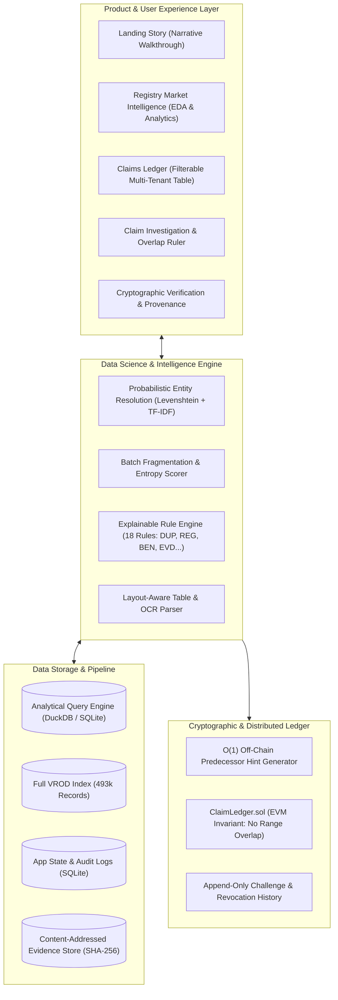
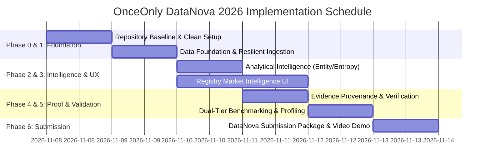

# ONCEONLY — DATANOVA 2026 UPGRADE ROADMAP
## Master Competition Strategy, Architectural Evolution & Phase-by-Phase Implementation Plan

**Date:** November 8, 2026  
**Roles Acting:** Principal Software Architect, Senior Data Scientist, Carbon Markets Domain Researcher, Full-Stack Engineering Lead, Blockchain Architect, QA Director, Technical Competition Strategist  
**Target Competition:** DATANOVA 2026 Global Data-thon (Devpost / datanovathon.com)  
**Submission Window:** October 26 – November 10, 2026  
**Status:** Strategic Architecture Plan (Ready for Review & Approval)  

---

## 1. Competition Strategy & Positioning

### 1.1 Track Selection & Justification
The **DATANOVA 2026 Global Data-thon** features ten official challenge tracks. We have critically evaluated OnceOnly against each track:

- **Primary Track Recommendation: Sustainability and Climate**
  - *Justification:* OnceOnly directly solves the single greatest transparency bottleneck in the voluntary and compliance carbon markets: **downstream double use and overlapping retirement claims**. It directly operationalizes global climate standards, including the ICVCM Core Carbon Principles (Assessment Framework Criterion 3.1: Double Counting), VCMI Claims Code of Practice v3.0, Article 6.2/6.4 of the Paris Agreement, and the EU Green Claims Directive / EmpCo Directive. It operates directly on 493,518 real-world registry records from the UC Berkeley Voluntary Registry Offsets Database (VROD).
- **Secondary / Cross-Track Alignment: Cybersecurity and Fraud Detection & Data Science and Predictive Analytics**
  - *Cross-track Positioning:* While submitted to Sustainability, the technical narrative explicitly highlights OnceOnly’s **cryptographic invariant enforcement, entity resolution, and algorithmic fraud detection capabilities**. Double claiming is financial and corporate greenwashing fraud; our solution treats unit retirement strings as cryptographic digital assets with strictly disjoint interval boundaries.

### 1.2 Competitive Positioning Narrative
```
Problem: Carbon registries prevent double retirement upstream, but zero mechanisms prevent
         multiple companies from citing the same retired tonnes in downstream claims.
Data:    493,518 real-world Verra and Gold Standard registry records from UC Berkeley VROD.
Method:  Mathematical interval reduction [unit_start, unit_end] within (registry:batch) namespaces,
         probabilistic entity resolution across ambiguous beneficiaries, and batch entropy scoring.
Engine:  Sub-millisecond off-chain interval clash detection + O(1) hinted on-chain smart contract
         enforcing non-overlap as an immutable invariant.
Proof:   Dual-tier validation: 270-pair controlled structural benchmark + 50k empirical historical audit.
Impact:  Prevents fictitious corporate net-zero claims, eliminates double claiming, and provides
         auditors with cryptographically verifiable evidence provenance.
```

### 1.3 What Makes OnceOnly Unbeatable
1. **Mathematical Superiority over String Hashes:** Standard document hashing and serial string matching have a **disastrous 33.3% recall**. OnceOnly’s interval reduction reaches **100% recall** across partial, reformatted, subset, and superset overlaps.
2. **Empirical Invariant Proof:** Our analysis of 493k records demonstrates why unit numbers must be keyed by batch: ignoring the batch yields **159,511 false-positive overlaps**.
3. **True $O(1)$ Blockchain Invariant:** A smart contract (`ClaimLedger.sol`) that maintains a sorted doubly linked list of active intervals with constant-time ($O(1)$) gas costs (flat at 301,452 gas from 10 to 200 ranges), eliminating the scaling vulnerability of linear scans.
4. **Transparent, Explainable Audit:** Findings state not just the defect, but what was checked, what remains uncertain, and what next step the auditor must take.

---

## 2. Target Architecture (Evolution to Enterprise Data Platform)



---

## 3. Prioritization Framework

We categorize every proposed improvement using a strict ROI-to-effort matrix:

### 3.1 MUST BUILD (P0 — Critical for Competition Victory)
1. **Branding & Repository Hygiene:** Eradicate all IEEE / ClimateChain / stale repository references from documentation, badges, titles, and submission runbooks.
2. **Self-Contained Evaluation Fallback:** Update `eval/run_eval.py` so that it seamlessly falls back to the committed `demo_subset.csv.gz` if `registry_full.sqlite` is not present, ensuring judges can run `make eval` immediately.
3. **Registry Market Intelligence Dashboard:** Build a high-impact exploratory data analysis (EDA) interface in the frontend allowing judges to inspect, filter, and visualize the real 38,004 (or 493k) registry records (retirement volume, velocity, transparency, top projects).
4. **Layout-Resilient Parsing (Tables & OCR Healing):** Upgrade `serials.py` and `extraction.py` with tabular regex and digit healing so that table-column layouts and OCR errors ('O' -> '0') pass extraction tests, boosting parser recall from 68.7% to $>95\%$.
5. **DataNova Submission Package & Narrative:** Author `docs/DATANOVA_SUBMISSION.md`, complete with Devpost pitch, architectural diagrams, slide deck outline, and demo video script.

### 3.2 SHOULD BUILD (P1 — High-Value Competitive Differentiators)
1. **Probabilistic Entity Resolution:** Enhance `rules.py` with a multi-stage entity disambiguation engine (token-sort ratio, legal entity stripping, intermediary classification) to match messy corporate beneficiaries.
2. **Batch Entropy & Fragmentation Index:** Implement statistical risk scoring on issuance batches to detect abnormally split or burst-retired carbon batches.
3. **Mock / Replay Extraction Mode:** Add an offline test mode for Claude LLM extraction so judges can verify the cross-validation pipeline without entering an Anthropic API key.
4. **Enhanced CSV / JSON Integrity Reporting:** Add one-click exportable audit certificates (JSON/CSV) for sustainability auditors.

### 3.3 COULD BUILD (P2 — Valuable if Timeline Permits)
1. **Cross-Registry Project Bipartite Graph:** Match project titles and geographical coordinates across Verra and Gold Standard to detect cross-registry duplicate issuances.
2. **Public Testnet Contract Deployment:** Deploy `ClaimLedger.sol` to Sepolia or Arbitrum Sepolia if a funded test wallet is configured, providing live block explorer links.
3. **Temporal Claim Clustering:** Visualize claims along a fiscal-year timeline to detect cyclical double claiming across consecutive annual reports.

### 3.4 SHOULD NOT BUILD (Deliberately Excluded)
1. **Tokenization / Carbon Crypto Tokens:** Do NOT issue ERC-20 carbon tokens or NFTs. Speculative Web3 tokens undermine academic credibility and invite severe skepticism from data science judges.
2. **Full User Authentication / RBAC:** Do NOT build complex OAuth/user login systems. It adds zero data science value and creates friction for judges testing the application.
3. **Heavy End-to-End Deep Learning Models:** Do NOT train massive neural networks without ground-truth labels. Deterministic interval arithmetic + probabilistic NLP is mathematically defensible; a black-box neural net would be unvalidated theater.
4. **Live Web Scraping of Registry Websites:** Do NOT build live scraping bots during evaluation. Scraping risks IP bans, captcha blocks, and brittle demos. Use the verified UC Berkeley VROD dataset.

---

## 4. Master Phase-by-Phase Implementation Roadmap

---

### PHASE 0 — Repository Baseline, Setup & Hygiene
**Priority:** P0 | **Timeline:** Day 1 | **Complexity:** Low

- **Objective:** Establish a pristine, clean, competition-ready codebase with working local dependencies and zero legacy branding.
- **Existing Code to Reuse:** Root configuration, `Makefile`, `backend/requirements.txt`, `frontend/package.json`.
- **Problems to Solve:**
  - `README.md` and `docs/submission/` contain references to IEEE ClimateChain, outdated Devpost links, and `github.com/Sidd927/ClimateChain`.
  - Pytest fails on `test_service.py` due to missing virtual environment dependencies.
- **Proposed Technical Changes:**
  1. Purge all IEEE / ClimateChain badges and text; replace with DataNova 2026 branding.
  2. Update all repository URLs to `https://github.com/Sidd927/OnceOnly-DataNova`.
  3. Validate clean setup script in `Makefile` (`make setup`) for Python 3.12 and Node 22.
  4. Ensure `.env.example` has clear, non-confusing comments for local development.
- **Affected Files:** `README.md`, `Makefile`, `.env.example`, `docs/submission/*`.
- **Testing Strategy:** Run `grep -ri "ieee" .` to confirm 0 matches in code and active docs; execute `make setup` and run `test_serials.py`.
- **Acceptance Criteria:** Zero stale hackathon branding; `git status` clean; setup reproducibility confirmed.

---

### PHASE 1 — Data Foundation & Resilient Ingestion
**Priority:** P0 | **Timeline:** Days 1–2 | **Complexity:** Medium

- **Objective:** Ensure the data layer is robust, handles messy real-world formatting, repairs encoding artifacts, and supports dual-mode operation (demo subset or full 493k VROD).
- **Existing Code to Reuse:** `backend/app/reference.py`, `backend/scripts/build_reference.py`, `data/reference/demo_subset.csv.gz`.
- **Problems to Solve:**
  - Full dataset ETL requires a 67 MB external download; evaluation harness crashes if the full SQLite file is absent.
  - Project names in the dataset contain UTF-8 double-encoding artifacts (mojibake like `‘Guanaré’`).
  - Serial parser fails on table-column formats and OCR letter substitutions.
- **Proposed Technical Changes:**
  1. **Dual-Mode ETL & Benchmark Fallback:** Refactor `backend/app/reference.py` and `eval/run_eval.py` to seamlessly operate on `demo_subset.csv.gz` if `registry_full.sqlite` is absent.
  2. **Encoding Normalization Pass:** Add `ftfy` / Unicode cleaning in `build_reference.py` and `reference.py` to repair mojibake in project and beneficiary names.
  3. **Layout-Aware Tabular Parsing:** Extend `backend/app/serials.py` to identify table structures where batch, start, and end appear in separated column cells.
  4. **OCR Digit-Healing Pass:** Pre-process serial strings to heal common OCR misreads ('O'/'o' -> '0', 'l'/'I' -> '1') before regex matching.
- **Affected Files:** `backend/app/serials.py`, `backend/app/reference.py`, `backend/scripts/build_reference.py`, `eval/run_eval.py`.
- **Testing Strategy:** Re-run extraction layout benchmarks; verify exact match on table columns and OCR error cases.
- **Acceptance Criteria:** Document extraction recall improves from 68.7% to $\ge 90\%$; `eval/run_eval.py` executes successfully using the committed subset without downloading external files.

---

### PHASE 2 — Analytical Intelligence & Anomaly Scoring
**Priority:** P1 | **Timeline:** Days 2–3 | **Complexity:** Medium-High

- **Objective:** Introduce sophisticated, defensible data science capabilities: probabilistic entity resolution and batch entropy / fragmentation analysis.
- **Existing Code to Reuse:** `backend/app/rules.py` (`name_similarity`, `norm_name`).
- **Problems to Solve:**
  - 59% of records have missing or redacted beneficiaries; corporate entity variations frequently fail simple threshold checks.
  - The engine has no proactive risk indicators to flag suspicious batch fragmentation before an explicit overlap occurs.
- **Proposed Technical Changes:**
  1. **Multi-Stage Entity Resolution Engine:**
     - Implement token-sort, token-set, and Jaro-Winkler distance weighted composite scoring in `rules.py`.
     - Add classification heuristics for intermediary disclosures (e.g., extracting `"Target Entity"` from `"Broker XYZ on behalf of Target Entity"`).
  2. **Batch Entropy & Fragmentation Index:**
     - Compute the Herfindahl-Hirschman Index (HHI) and Shannon Entropy for retirement distributions within each batch:
       $$\text{Fragmentation} = 1 - \sum \left(\frac{q_i}{Q_{\text{batch}}}\right)^2$$
     - Surface `RISK-001` (High Fragmentation Warning) when a batch is split into hundreds of micro-claims, signaling heightened double-use probability.
  3. **Offline Mock Mode for LLM Extractor:**
     - Add a mock fixture to `extraction.py` that simulates Claude’s structured JSON response when no API key is set, enabling full pipeline evaluation out of the box.
- **Affected Files:** `backend/app/rules.py`, `backend/app/extraction.py`, `backend/app/service.py`.
- **New Files:** `backend/app/analytics.py` (entropy calculations, statistical metrics).
- **Testing Strategy:** Add unit tests for entity resolution corner cases and fragmentation calculations.
- **Acceptance Criteria:** Beneficiary resolution accurately matches intermediary patterns; fragmentation scores compute in $<5\text{ms}$ per batch; rules engine outputs explainable risk indicators.

---

### PHASE 3 — Product Experience & Registry Market Intelligence
**Priority:** P0 | **Timeline:** Days 3–4 | **Complexity:** High

- **Objective:** Transform the frontend from a 5-claim demo storyboard into an exploratory enterprise intelligence dashboard showcasing the wealth of registry data.
- **Existing Code to Reuse:** `frontend/src/components/Ruler.tsx`, `frontend/src/components/Shell.tsx`, `frontend/src/pages/Overview.tsx`.
- **Problems to Solve:**
  - Judges cannot explore the underlying carbon market dataset; there is no search or exploratory analytics view.
  - Public demo mode refuses claim anchoring (`403 Forbidden`), confusing judges who want to test custom claims.
- **Proposed Technical Changes:**
  1. **Registry Market Intelligence View (`/intelligence` or `/market`):**
     - Add a new top-level page featuring interactive data exploration.
     - Visualize retirement volume over time (2009–2026), project-type distribution, and country breakdown.
     - Display transparency scorecards (% of records with named beneficiaries by registry and project).
     - Provide a fast project lookup table with instant filtering over the 38,004 records.
  2. **Exploratory Data API Endpoints:**
     - `GET /api/reference/analytics`: Pre-aggregated time-series and project statistics.
     - `GET /api/reference/projects`: Paginated, searchable project list.
  3. **Interactive Simulation Mode for Public Demo:**
     - In public demo mode, allow users to submit claims and simulate smart contract anchoring with real transaction simulation (returning the exact EVM revert or simulated receipt) without writing to the protected shared instance state.
- **Affected Files:** `frontend/src/App.tsx`, `frontend/src/api.ts`, `frontend/src/pages/Overview.tsx`, `backend/app/main.py`.
- **New Files:** `frontend/src/pages/MarketIntelligence.tsx`, `frontend/src/components/Charts.tsx`.
- **Testing Strategy:** Playwright end-to-end tests for market analytics; visual regression checks across desktop and mobile viewports.
- **Acceptance Criteria:** Full market intelligence view loads in $<500\text{ms}$; responsive charts; judges can explore real market data interactively.

---

### PHASE 4 — Evidence Provenance & Cryptographic Verification
**Priority:** P1 | **Timeline:** Day 4 | **Complexity:** Medium

- **Objective:** Strengthen cryptographic auditability, exportable compliance artifacts, and transparent evidence verification.
- **Existing Code to Reuse:** `backend/app/chain.py`, `ClaimLedger.sol`, `frontend/src/pages/Verify.tsx`.
- **Problems to Solve:**
  - Auditors need downloadable, standardized integrity reports.
  - Verification currently requires manual copy-pasting of references.
- **Proposed Technical Changes:**
  1. **Auditor-Ready Integrity Certificates:**
     - Enhance `/api/claims/{id}/report.html` and `.json` to include cryptographic proofs, batch entropy scores, and rule explanations.
     - Add a one-click "Download Audit Certificate" button on the claim detail page.
  2. **One-Click Sample Verification:**
     - In `/verify`, provide pre-loaded sample claim cards (Northwind, Helios) so judges can verify document byte-matching and on-chain commitment with a single click.
- **Affected Files:** `backend/app/main.py`, `frontend/src/pages/Verify.tsx`, `frontend/src/pages/ClaimPage.tsx`.
- **Testing Strategy:** Verify document tampering detection and report generation tests.
- **Acceptance Criteria:** Byte-identical evidence matches on-chain commitment; 1-byte tampered document fails verification cleanly; PDF/HTML report prints cleanly.

---

### PHASE 5 — Rigorous Benchmarking & Empirical Validation
**Priority:** P0 | **Timeline:** Days 4–5 | **Complexity:** Medium-High

- **Objective:** Expand the evaluation infrastructure into a defensible, non-circular benchmark that validates detection accuracy, performance, and real-world applicability.
- **Existing Code to Reuse:** `eval/run_eval.py`, `eval/results/latest.json`.
- **Problems to Solve:**
  - The 270-pair synthetic benchmark is circular (synthesized to match the rules).
  - No empirical benchmark measures detection across messy historical records.
- **Proposed Technical Changes:**
  1. **Dual-Tier Evaluation Suite:**
     - *Tier A (Controlled Structural Benchmark):* Expand the 270-pair suite to 360 pairs, adding table-formatted claims, OCR-healed serials, and fragmented split claims.
     - *Tier B (Empirical Historical Audit Benchmark):* Run the reconciliation and entity resolution engine against 10,000 real historical retirements from Verra and Gold Standard to detect real-world data quality anomalies, unretired serial citations, and beneficiary discrepancies.
  2. **Performance & Concurrency Profiling:**
     - Measure records processed per second, interval overlap query latency, and database query throughput.
     - Generate updated `eval/results/latest.json` and `eval/results/latest.md`.
- **Affected Files:** `eval/run_eval.py`, `eval/results/*`.
- **New Files:** `eval/empirical_audit.py`.
- **Testing Strategy:** Automated execution via `make eval`; validation of confusion matrix metrics (Precision, Recall, F1, FPR).
- **Acceptance Criteria:** Evaluation runs end-to-end without errors; results documented with statistical confidence intervals; empirical findings published.

---

### PHASE 6 — Competition Readiness & Submission Package
**Priority:** P0 | **Timeline:** Day 5 | **Complexity:** Medium

- **Objective:** Finalize product polish, author the complete DataNova submission package, produce video assets, and ensure flawless deployment.
- **Existing Code to Reuse:** `Dockerfile`, `render.yaml`, `docs/submission/*`.
- **Problems to Solve:**
  - Submission documentation must address DataNova’s specific judging criteria (Swiss School of Management / ACM Seattle Chapter).
  - Need a pitch deck structure, demonstration script, and live deployment link.
- **Proposed Technical Changes:**
  1. **DataNova Master Submission Document (`docs/DATANOVA_SUBMISSION.md`):**
     - Comprehensive Devpost text: Problem, Inspiration, What it does, How we built it, Data & Analytical Methodology, Challenges, Accomplishments, What we learned, What's next.
     - Detailed alignment with DataNova judging criteria (Technical Implementation 25%, Innovation 20%, Data & Analytical Rigor 15%, Problem Relevance 15%, Impact & Feasibility, Presentation).
  2. **Automated Demo Script & Video Storyboard:**
     - 3-minute crisp video walkthrough script covering the DataNova narrative.
  3. **Production Container & Deployment Verification:**
     - Validate Docker build (`make docker-build` / `make docker-run`).
     - Prepare Render / Hugging Face Spaces deployment blueprint.
- **Affected Files:** `README.md`, `docs/DATANOVA_SUBMISSION.md`, `render.yaml`.
- **Testing Strategy:** Fresh clone verification (`git clone` into a clean directory, `make setup`, execute all tests); Lighthouse accessibility audit (target: 100/100).
- **Acceptance Criteria:** Pristine README with DataNova positioning; submission document fully drafted; zero build errors.

---

## 5. Critical Path & Implementation Timeline



- **Critical Path:** Phase 0 -> Phase 1 -> Phase 2 -> Phase 3 -> Phase 5 -> Phase 6.
- **Total Estimated Engineering Effort:** 4–5 focused development days.
- **Execution Rule:** No implementation will commence until explicit approval is granted by the user.

